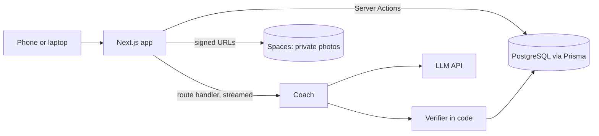

# Architecture (draft)

## How it is used

A mobile-first website, used on the phone at the gym and on a laptop at home.

| When   | What the user does                                                                                                |
| ------ | ----------------------------------------------------------------------------------------------------------------- |
| Before | Takes the quiz (goal, days a week, equipment, injuries), gets a plan built from our exercise library              |
| During | Opens today's session: logs sets with large buttons, rest timer, asks the coach ("bench is taken, what instead?") |
| After  | Sees streaks, a calendar heatmap and progress photos                                                              |

The coach is a chat panel on every page, not only the body map. Tapping a muscle on the body map opens the chat with that exercise and spot already filled in.

## The coach

**Grounded, not free-form.** Every request sends the model this user's profile, plan, last workouts, the current conversation and the matching exercise library entries. The model is stateless; the conversation lives in our database, scoped to the user, so one user's data never reaches another user's request.

**Plans are picked, not invented.** The model chooses exercises by ID from our library and fills sets, reps and rest. It cannot name an exercise we do not have.

**A verifier checks everything before it is saved or shown.** Plain TypeScript, unit-tested, no second model:

- the reply matches the JSON schema
- every exercise ID exists and fits the user's equipment and reported injuries
- sets, reps and rest are in range; no exercise twice on one day
- a swap suggestion targets the same muscle as the original

A plan that fails is regenerated once, then the user gets a rule-based default plan.

**Safety rules are code, not prompt.** If the user reports pain (not effort), the coach stops the exercise and suggests a professional. It does not diagnose.

**Form feedback questions are bounded:** where it is felt, at which point in the rep, the weight against usual. The answers pick a fix from the exercise's library entry (cues, common mistakes), so the advice traces to text we wrote.

**Text, not voice.** Voice adds speech-to-text, text-to-speech, microphone permissions and latency, and is not one of the course's advanced features. Streamed text replies are.

## Decisions

|     | Choice                                                                  | Why                                                                                                                                                                                                                                                    | Cost                                                                              |
| --- | ----------------------------------------------------------------------- | ------------------------------------------------------------------------------------------------------------------------------------------------------------------------------------------------------------------------------------------------------ | --------------------------------------------------------------------------------- |
| D1  | Next.js App Router (option A) ([research](RESEARCH.md#2-architecture))  | Nothing outside the app calls the backend, so no public REST API is needed. Server Components load data on the server; Server Actions are typed form handlers with CSRF protection; route handlers cover the Stripe webhook and streamed coach replies | Tied to Next.js; a mobile app later needs an API                                  |
| D2  | PostgreSQL with Prisma                                                  | Relational data: user to plan to exercises to logged sets; typed queries and committed migrations                                                                                                                                                      | Complex reports may need raw SQL                                                  |
| D3  | Private Spaces bucket, key in the database                              | Photos are personal; short-lived signed URLs for upload and view                                                                                                                                                                                       | A server round trip per photo                                                     |
| D4  | Groq first, Gemini as fallback ([research](RESEARCH.md#2-architecture)) | More free requests a day than Gemini, no card, and Gemini's free tier may use prompts to improve Google's products                                                                                                                                     | Two providers behind one function; prompts tested on both                         |
| D5  | Deploy to a hosted platform for the demo                                | A live URL is shown in the presentation and README; it tests env vars, secrets and storage the way users meet them                                                                                                                                     | Hosted database and setup time; free-tier limits. Running locally is the fallback |

## Advanced features

Promised: authentication with four access tiers checked on the server; external APIs (the coach).
Planned ([shortcuts](RESEARCH.md#3-plan-shortcuts-for-the-advanced-features)): real-time (streamed replies, notifications), photo processing (resize, strip location, then-vs-now image), Redux Toolkit for the quiz, body map and workout session, Stripe test mode.

## Open

Listed in [RESEARCH.md](RESEARCH.md#for-the-next-meeting) for the next meeting.
