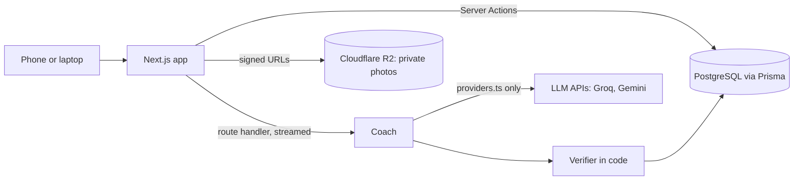

# Architecture (draft)

## How it is used

A mobile-first website, used on the phone at the gym and on a laptop at home.

| When   | What the user does                                                                                                |
| ------ | ----------------------------------------------------------------------------------------------------------------- |
| Before | Takes the quiz (goal, days a week, equipment, injuries), gets a plan built from our exercise library              |
| During | Opens today's session: logs sets with large buttons, rest timer, asks the coach ("bench is taken, what instead?") |
| After  | Sees streaks, a calendar heatmap and progress photos                                                              |

The coach is a chat panel on every page, not only the body map. Tapping a muscle on the body map opens the chat with that exercise and spot already filled in.

## The coach

**Grounded, not free-form.** Every request sends the model this user's profile, plan, last workouts, the current conversation and the matching exercise library entries. The model is stateless; the conversation lives in our database, scoped to the user, so one user's data never reaches another user's request.

**Plans are picked, not invented.** The model chooses exercises by ID from our library and fills sets, reps, rest and a target RPE of 6 to 9 (D17). It cannot name an exercise we do not have.

**A verifier checks everything before it is saved or shown.** Plain TypeScript, unit-tested, no second model:

- the reply matches the JSON schema
- every exercise ID exists and fits the user's equipment and reported injuries
- sets, reps, rest and RPE are in range; no exercise twice on one day
- a swap suggestion targets the same muscle as the original

A plan that fails is regenerated once with the problems listed, then the user gets a rule-based default plan. A rate limit or outage at the provider is retried with backoff, then the request moves to the other provider (D6); only after both fail does the user see the default plan.

**The coach sees the whole library.** Every exercise the user can do (their equipment, nothing that works a reported injury) goes into the prompt by name, grouped by muscle; nothing is cut for length (D7). The model answers with names, code maps them to ids, and the verifier checks the ids.

**Safety rules are code, not prompt.** If the user reports pain (not effort), the coach stops the exercise and suggests a professional. It does not diagnose. The rules are in `src/lib/coach/guardrails.ts` (#43): each user message is to be checked before a model call and each reply before it is shown, once the chat code (#53) and the coach route (#11) call them; a crisis message gets a fixed reply with 9-8-8 and 911, exaggeration in training talk or distress with no training context a short check-in that still names 9-8-8, a model safety check runs first and can only raise the response (D15), a red-flag symptom (chest pain, fainting, trouble breathing) a fixed stop-and-seek-care reply, and disordered eating the NEDIC helpline; a reply that diagnoses or names a dose is replaced; off-topic requests get a one-line redirect; user text only ever goes in as the user message.

**Form feedback questions are bounded:** where it is felt, at which point in the rep, the weight against usual. The answers pick a fix from the exercise's library entry (cues, common mistakes), so the advice traces to text we wrote.

**One chat turn, in a fixed order** (`src/lib/coach/chat.ts`, #11): the safety screen and guardrail check on the message (a short follow-up to the coach's own training reply is let through the off-topic rule only), then the model with a system prompt built from this user's plan and profile, then the check on the reply. If no provider answers, the user gets a short fixed reply and workout logging keeps working. Plans and chat use the same provider order (`coachModel`, `coachChatModel`). The off-topic rule sends a message of four or more words with no training word to the redirect without a model call, so the turn writes no coach record. On 24 Nov "explain one of the workouts for me" got the redirect while "explain today's workout" was answered, because the list held only "workout". A second list of plural and verb forms ("workouts", "exercises", "exercising", "weights") now keeps such a message out of the redirect. It does not take part in the check-in: a message of four or more words with crisis words and no word from the first list still gets the check-in with 9-8-8 (D15), so "I want to give up on my workouts" is not sent to the model. "Plans", "work out" and "routine" stay out as too loose ("what are your plans for the holidays", "work out a time for dinner"). This beat dropping the word-list redirect and letting the model decide, which would cost a provider call on every off-topic message and lean on the prompt alone. The cost: a few off-topic messages with a plural form ("the best weights for my chemistry exam") reach the model, where the system prompt and the reply check still apply.

**AI only through `providers.ts`.** `src/lib/coach/providers.ts` is the one module that calls a model API (Groq first, Gemini as fallback, D4 and D6). No route handler, Server Action or component calls a provider directly. A new model path, such as the chat screen (#63) or the exercise chat (#70), goes through it and so gets the retries, timeouts, fallback and `coachLog` record. Coach modules pass typed data to each other, never raw model text. On `main` on 10 November, `providers.ts` and, by the exception recorded under D15, `safetyModel.ts` (the safety check, not yet called on `main`) hold the provider URLs. Core features (sign-in, quiz, rule-based plan, logging) work with no model key (8 November [design review](design-reviews/2026-11-08-review.md), decision 1, #76).

**No nutrition advice.** Scope is lifting, strength training and running. The coach gives no diet, calorie, supplement or meal advice; a nutrition question gets a short out-of-scope reply pointing to a registered dietitian (decision 5, #43).

**Text, not voice.** Voice adds speech-to-text, text-to-speech, microphone permissions and latency, and is not one of the course's advanced features. Streamed text replies are.

## Decisions

|     | Choice                                                                                                                                                                                                                                                                                                                                                                                                                                                                                                                                                                                                                                                                                                                                                                                                                                                                                                                                                                                                                                                                                                                                                                                                                                                                                                                                                                                                                                                                                                                                                                                               | Why                                                                                                                                                                                                                                                                                                                                                                                                                                                                                                                                                                                                                                                                                                                                                                                                                                                                                                                                                                                                                                                                                                                                                                                                                                               | Cost                                                                                                                                                                                                                                                                                                                                                                                                                                                                                                                                                                                            |
| --- | ---------------------------------------------------------------------------------------------------------------------------------------------------------------------------------------------------------------------------------------------------------------------------------------------------------------------------------------------------------------------------------------------------------------------------------------------------------------------------------------------------------------------------------------------------------------------------------------------------------------------------------------------------------------------------------------------------------------------------------------------------------------------------------------------------------------------------------------------------------------------------------------------------------------------------------------------------------------------------------------------------------------------------------------------------------------------------------------------------------------------------------------------------------------------------------------------------------------------------------------------------------------------------------------------------------------------------------------------------------------------------------------------------------------------------------------------------------------------------------------------------------------------------------------------------------------------------------------------------- | ------------------------------------------------------------------------------------------------------------------------------------------------------------------------------------------------------------------------------------------------------------------------------------------------------------------------------------------------------------------------------------------------------------------------------------------------------------------------------------------------------------------------------------------------------------------------------------------------------------------------------------------------------------------------------------------------------------------------------------------------------------------------------------------------------------------------------------------------------------------------------------------------------------------------------------------------------------------------------------------------------------------------------------------------------------------------------------------------------------------------------------------------------------------------------------------------------------------------------------------------- | ----------------------------------------------------------------------------------------------------------------------------------------------------------------------------------------------------------------------------------------------------------------------------------------------------------------------------------------------------------------------------------------------------------------------------------------------------------------------------------------------------------------------------------------------------------------------------------------------- |
| D1  | Next.js App Router (option A) ([research](RESEARCH.md#2-architecture))                                                                                                                                                                                                                                                                                                                                                                                                                                                                                                                                                                                                                                                                                                                                                                                                                                                                                                                                                                                                                                                                                                                                                                                                                                                                                                                                                                                                                                                                                                                               | Nothing outside the app calls the backend, so no public REST API is needed. Server Components load data on the server; Server Actions are typed form handlers with CSRF protection; route handlers cover the Stripe webhook and streamed coach replies                                                                                                                                                                                                                                                                                                                                                                                                                                                                                                                                                                                                                                                                                                                                                                                                                                                                                                                                                                                            | Tied to Next.js; a mobile app later needs an API                                                                                                                                                                                                                                                                                                                                                                                                                                                                                                                                                |
| D2  | PostgreSQL with Prisma                                                                                                                                                                                                                                                                                                                                                                                                                                                                                                                                                                                                                                                                                                                                                                                                                                                                                                                                                                                                                                                                                                                                                                                                                                                                                                                                                                                                                                                                                                                                                                               | Relational data: user to plan to exercises to logged sets; typed queries and committed migrations. Indexes follow the queries on `main`: `Plan(userId, active, createdAt)` for the session screen, onboarding and `saveWeek`, `Workout(userId, planId, finishedAt)` for the session screen and its actions (8 Nov, #76, [research](RESEARCH.md#2-architecture))                                                                                                                                                                                                                                                                                                                                                                                                                                                                                                                                                                                                                                                                                                                                                                                                                                                                                   | Complex reports may need raw SQL                                                                                                                                                                                                                                                                                                                                                                                                                                                                                                                                                                |
| D3  | Private Cloudflare R2 bucket (S3-compatible), key in the database                                                                                                                                                                                                                                                                                                                                                                                                                                                                                                                                                                                                                                                                                                                                                                                                                                                                                                                                                                                                                                                                                                                                                                                                                                                                                                                                                                                                                                                                                                                                    | Photos are personal. Uploads go through a Server Action that resizes the photo and removes its metadata (including GPS) with sharp before saving it to R2; viewing uses short-lived signed URLs (changed 12 Nov, agreed in #16). Vercel Functions reject request bodies over 4.5 MB ([Vercel Functions limits](https://vercel.com/docs/functions/limitations), checked 13 Nov 2026), so the browser first shrinks photos of up to 50 MB to under 4 MB, and the server accepts up to 4 MB. Each account can keep up to 1,000 photos; at an estimated 300 KB each, a full account uses about 300 MB, so roughly 33 full accounts would fill the free tier below. That is fine for the course; the cap or the storage plan should be revisited before real users. R2 free tier: 10 GB-month of Standard storage, 1M Class A and 10M Class B operations a month, no egress fees ([Cloudflare R2 pricing](https://developers.cloudflare.com/r2/pricing/), checked 6 Nov 2026); DigitalOcean Spaces has no free tier. Changed 6 Nov from Spaces, as Farnaz proposed in #16                                                                                                                                                                              | A server round trip per photo                                                                                                                                                                                                                                                                                                                                                                                                                                                                                                                                                                   |
| D4  | Groq first, Gemini as fallback ([research](RESEARCH.md#2-architecture))                                                                                                                                                                                                                                                                                                                                                                                                                                                                                                                                                                                                                                                                                                                                                                                                                                                                                                                                                                                                                                                                                                                                                                                                                                                                                                                                                                                                                                                                                                                              | More free requests a day than Gemini, no card, and Gemini's free tier may use prompts to improve Google's products                                                                                                                                                                                                                                                                                                                                                                                                                                                                                                                                                                                                                                                                                                                                                                                                                                                                                                                                                                                                                                                                                                                                | Two providers behind one function; prompts tested on both                                                                                                                                                                                                                                                                                                                                                                                                                                                                                                                                       |
| D6  | Retry, then the other provider, then the rule-based plan (30 Oct, [eval](COACH_EVAL.md))                                                                                                                                                                                                                                                                                                                                                                                                                                                                                                                                                                                                                                                                                                                                                                                                                                                                                                                                                                                                                                                                                                                                                                                                                                                                                                                                                                                                                                                                                                             | Free tiers fail inside ten requests: Groq's 8,000 tokens a minute, Gemini's 20 requests a day on Flash; in the eval the chain served 10 of 10 plans where either provider alone did not                                                                                                                                                                                                                                                                                                                                                                                                                                                                                                                                                                                                                                                                                                                                                                                                                                                                                                                                                                                                                                                           | Two keys to manage; the fallback model (Gemini 3.5 Flash-Lite) needs a retry more often                                                                                                                                                                                                                                                                                                                                                                                                                                                                                                         |
| D7  | The whole eligible exercise list in every plan prompt, as names grouped by muscle (30 Oct, [eval](COACH_EVAL.md))                                                                                                                                                                                                                                                                                                                                                                                                                                                                                                                                                                                                                                                                                                                                                                                                                                                                                                                                                                                                                                                                                                                                                                                                                                                                                                                                                                                                                                                                                    | The team wants every exercise available to the coach; grouped names cost 4,700 tokens for the full gym against 7,900 for one line per id                                                                                                                                                                                                                                                                                                                                                                                                                                                                                                                                                                                                                                                                                                                                                                                                                                                                                                                                                                                                                                                                                                          | One plan a minute per account on Groq's free tier; near-miss names need forgiving matching in code                                                                                                                                                                                                                                                                                                                                                                                                                                                                                              |
| D8  | Running weeks built by rule, capped at 10% over last week's logged distance (3 Nov, #34)                                                                                                                                                                                                                                                                                                                                                                                                                                                                                                                                                                                                                                                                                                                                                                                                                                                                                                                                                                                                                                                                                                                                                                                                                                                                                                                                                                                                                                                                                                             | Running progressions are arithmetic; a rule is testable and needs no model call                                                                                                                                                                                                                                                                                                                                                                                                                                                                                                                                                                                                                                                                                                                                                                                                                                                                                                                                                                                                                                                                                                                                                                   | Less variety than a model-written week; the coach can still explain it                                                                                                                                                                                                                                                                                                                                                                                                                                                                                                                          |
| D9  | Hybrid split by goal and training mode (3 Nov)                                                                                                                                                                                                                                                                                                                                                                                                                                                                                                                                                                                                                                                                                                                                                                                                                                                                                                                                                                                                                                                                                                                                                                                                                                                                                                                                                                                                                                                                                                                                                       | Strength or muscle goals get about 60% strength days; fat loss gets two strength days (one at two days a week) and the rest runs; a hybrid week of two or more days keeps at least one day of each kind; runners keep one strength day from three days a week and two from four, for injury prevention; at most five run days                                                                                                                                                                                                                                                                                                                                                                                                                                                                                                                                                                                                                                                                                                                                                                                                                                                                                                                     | A fixed rule; chat adjustment is planned (#11), and each day passes its verifier once onboarding saves the week (#46)                                                                                                                                                                                                                                                                                                                                                                                                                                                                           |
| D5  | Deploy to a hosted platform for the demo                                                                                                                                                                                                                                                                                                                                                                                                                                                                                                                                                                                                                                                                                                                                                                                                                                                                                                                                                                                                                                                                                                                                                                                                                                                                                                                                                                                                                                                                                                                                                             | A live URL is shown in the presentation and README; it tests env vars, secrets and storage the way users meet them                                                                                                                                                                                                                                                                                                                                                                                                                                                                                                                                                                                                                                                                                                                                                                                                                                                                                                                                                                                                                                                                                                                                | Hosted database and setup time; free-tier limits. Running locally is the fallback                                                                                                                                                                                                                                                                                                                                                                                                                                                                                                               |
| D10 | Stream coach replies a sentence at a time, checked before each sentence goes out (3 Nov, #11)                                                                                                                                                                                                                                                                                                                                                                                                                                                                                                                                                                                                                                                                                                                                                                                                                                                                                                                                                                                                                                                                                                                                                                                                                                                                                                                                                                                                                                                                                                        | Token streaming would show a diagnosis before the reply check could catch it; a sentence at a time still feels live, and the check runs on everything so far before any new text is shown. The other provider is tried only before the first text piece arrives from the first one, so an error before any text (HTTP, a dropped connection, an error event, or a stream that ends with no text) still falls back. Each streamed call writes one coach record, as a plain call does (#41)                                                                                                                                                                                                                                                                                                                                                                                                                                                                                                                                                                                                                                                                                                                                                         | Slightly later first text than token streaming; a reply cut by the check ends with the fixed line; a drop after the first text piece but before a full sentence shows only the unavailable line; the 30-second request timeout also covers reading the reply; the stream has no same-provider retry, so a 429 or 5xx goes straight to the other provider, or to the unavailable line when only one key is set                                                                                                                                                                                   |
| D11 | Onboarding shows the rule-based plan instantly; the coach personalizes on demand (3 Nov [design review](design-reviews/2026-11-03-coach.md), #58)                                                                                                                                                                                                                                                                                                                                                                                                                                                                                                                                                                                                                                                                                                                                                                                                                                                                                                                                                                                                                                                                                                                                                                                                                                                                                                                                                                                                                                                    | No 2 to 15 second wait at sign-up and no quota spent on every new user; the model runs when the user asks, behind the same verifier                                                                                                                                                                                                                                                                                                                                                                                                                                                                                                                                                                                                                                                                                                                                                                                                                                                                                                                                                                                                                                                                                                               | The first plan is generic until the user asks the coach                                                                                                                                                                                                                                                                                                                                                                                                                                                                                                                                         |
| D12 | Demo-critical coach outputs are cached and the fallback is immediate in demo mode (3 Nov design review, #59)                                                                                                                                                                                                                                                                                                                                                                                                                                                                                                                                                                                                                                                                                                                                                                                                                                                                                                                                                                                                                                                                                                                                                                                                                                                                                                                                                                                                                                                                                         | Several people on the Groq and Gemini free tiers at once would exhaust both; a provider drop must not show a 30-second wait                                                                                                                                                                                                                                                                                                                                                                                                                                                                                                                                                                                                                                                                                                                                                                                                                                                                                                                                                                                                                                                                                                                       | Cached outputs must be refreshed when the prompt changes                                                                                                                                                                                                                                                                                                                                                                                                                                                                                                                                        |
| D13 | A pain question gets safe programming guidance; a pain report stops the exercise (3 Nov design review, #48)                                                                                                                                                                                                                                                                                                                                                                                                                                                                                                                                                                                                                                                                                                                                                                                                                                                                                                                                                                                                                                                                                                                                                                                                                                                                                                                                                                                                                                                                                          | A hard stop on every mention of pain frustrates a user asking how to train safely; neither path diagnoses                                                                                                                                                                                                                                                                                                                                                                                                                                                                                                                                                                                                                                                                                                                                                                                                                                                                                                                                                                                                                                                                                                                                         | One more rule to test; the line between a question and a report is decided in code                                                                                                                                                                                                                                                                                                                                                                                                                                                                                                              |
| D14 | Merge order: schema, then logic, then screens; the author merges after 72 hours without a review (3 Nov design review)                                                                                                                                                                                                                                                                                                                                                                                                                                                                                                                                                                                                                                                                                                                                                                                                                                                                                                                                                                                                                                                                                                                                                                                                                                                                                                                                                                                                                                                                               | Ten stacked pull requests made coordination the bottleneck                                                                                                                                                                                                                                                                                                                                                                                                                                                                                                                                                                                                                                                                                                                                                                                                                                                                                                                                                                                                                                                                                                                                                                                        | Some code merges having been read only by its author                                                                                                                                                                                                                                                                                                                                                                                                                                                                                                                                            |
| D15 | Crisis and red-flag screening in three layers (6 Nov, #43): a model safety check first (Groq `openai/gpt-oss-safeguard-20b` with our own written policy), then the word list as the deterministic floor, then a short check-in with 9-8-8 for distress wording without training context, for exaggeration tied to a session such as "I'm gonna die on this run" (unless the message states intent), and for any message with crisis words that would otherwise get the off-topic redirect                                                                                                                                                                                                                                                                                                                                                                                                                                                                                                                                                                                                                                                                                                                                                                                                                                                                                                                                                                                                                                                                                                            | Four independent reviews on 6 Nov each found crisis and cardiac phrasings the word list missed; a word list alone cannot keep up with how people phrase distress. A policy-following safety model reads meaning, and Groq documents it for bring-your-own-policy moderation ([content moderation](https://console.groq.com/docs/content-moderation) and [model page](https://console.groq.com/docs/model/openai/gpt-oss-safeguard-20b), checked 6 Nov)                                                                                                                                                                                                                                                                                                                                                                                                                                                                                                                                                                                                                                                                                                                                                                                            | The model is in preview and adds one call before each chat reply; it can only raise the response, never lower what the word list finds, and a distress reading never replaces a reply that already gives specific help (eating support, a pain stop); and if it is down or slow the word list and check-in decide alone                                                                                                                                                                                                                                                                         |
| D17 | Every plan exercise carries a target RPE of 6 to 9, checked by the verifier and not yet stored (#65). Chosen over a categorical intensity as in Bloom (Jörke et al., arXiv 2510.05449), which cannot be checked against a number, and over %1RM, which needs a lift we have not seen. RPE here is the reps-in-reserve scale (Helms et al. 2016, Strength Cond J 38(4), Table 1: 9 = one rep left, 7 = three left). Not stored because `PlanExercise` has no `rpe` column and a migration is out of scope for #65; storing it is a follow-up.                                                                                                                                                                                                                                                                                                                                                                                                                                                                                                                                                                                                                                                                                                                                                                                                                                                                                                                                                                                                                                                         | 10 Nov                                                                                                                                                                                                                                                                                                                                                                                                                                                                                                                                                                                                                                                                                                                                                                                                                                                                                                                                                                                                                                                                                                                                                                                                                                            |
| D18 | The starter plan and the coach's fallback pick from free-exercise-db category `strength` only (8 Nov, #71, found on #15; one exception, the warm-up of D25)                                                                                                                                                                                                                                                                                                                                                                                                                                                                                                                                                                                                                                                                                                                                                                                                                                                                                                                                                                                                                                                                                                                                                                                                                                                                                                                                                                                                                                          | The dataset lists stretches before the first strength match for some muscles, so a muscle-first pick gave a Legs day of stretches. The input type requires `category`, so TypeScript flags any caller that does not load it. Beaten: keeping every non-stretching category, which lets plyometrics and powerlifting in                                                                                                                                                                                                                                                                                                                                                                                                                                                                                                                                                                                                                                                                                                                                                                                                                                                                                                                            | A smaller pool, so some days get fewer exercises; plans the model writes are not filtered by category yet                                                                                                                                                                                                                                                                                                                                                                                                                                                                                       |
| D16 | Error state at the root (`error.tsx`); loading states inside the page, below its sign-in check, never a `loading.tsx` above a page that redirects (8 Nov, #72, FE-28; changed 13 Nov)                                                                                                                                                                                                                                                                                                                                                                                                                                                                                                                                                                                                                                                                                                                                                                                                                                                                                                                                                                                                                                                                                                                                                                                                                                                                                                                                                                                                                | The root `error.tsx` covers every page without its own (all but `/coach`, which has `src/app/coach/error.tsx` from #96); its button calls `retry()`, which re-fetches, where `reset()` does not ([Next.js error docs](https://nextjs.org/docs/app/api-reference/file-conventions/error), 8 Nov). A root `loading.tsx` (Lecture 8 p47-55) was removed on 13 Nov: its fallback starts the response with a 200 before the page's sign-in check can redirect, so a signed-out request to `/account`, `/session` or `/onboarding` got a 200 with a client-side redirect instead of a 307 ([Next.js streaming guide, the HTTP contract](https://nextjs.org/docs/app/guides/streaming), [loading docs, status codes](https://nextjs.org/docs/app/api-reference/file-conventions/loading#status-codes), checked 13 Nov). A page that guards with `redirect()` puts `<Suspense>` around its slow part, after the check. Beat keeping the shared fallback and redirecting earlier in a Proxy file: the pages keep their own check either way (a `require*` helper from `src/lib/auth/session.ts` or `src/lib/auth/access.ts` is called at every protected page and action), and a second place that decides who is signed in would sit in the accounts area | No shared loading fallback: each page that loads slowly adds its own `<Suspense>`; a browser test asserts the 307 for the four guarded pages outside `/coach` (`/coach` has its own); a root layout error needs `global-error.tsx`, not added                                                                                                                                                                                                                                                                                                                                                   |
| D19 | Vercel Hobby for the app, Neon Free for PostgreSQL (5 Nov, #57; sources below)                                                                                                                                                                                                                                                                                                                                                                                                                                                                                                                                                                                                                                                                                                                                                                                                                                                                                                                                                                                                                                                                                                                                                                                                                                                                                                                                                                                                                                                                                                                       | Both free; Vercel builds Next.js with no server to run and gives every pull request a preview URL; functions run up to 300 s, enough for a streamed coach reply; Neon keeps the database with no expiry. Beat Render and Railway (details below)                                                                                                                                                                                                                                                                                                                                                                                                                                                                                                                                                                                                                                                                                                                                                                                                                                                                                                                                                                                                  | Hobby is non-commercial; Neon sleeps after 5 idle minutes; each Git branch with a preview gets its own Neon branch copied from production, so Deployment Protection stays on (below)                                                                                                                                                                                                                                                                                                                                                                                                            |
| D20 | shadcn/ui on Base UI, Nova preset, in `src/components/ui` (8 Nov, #75; [research](RESEARCH.md#ui-components))                                                                                                                                                                                                                                                                                                                                                                                                                                                                                                                                                                                                                                                                                                                                                                                                                                                                                                                                                                                                                                                                                                                                                                                                                                                                                                                                                                                                                                                                                        | A course core requirement; the CLI default and Nabeegh's Assignment 4 setup. Beat Radix and React Aria, the other two bases. The root page is the example                                                                                                                                                                                                                                                                                                                                                                                                                                                                                                                                                                                                                                                                                                                                                                                                                                                                                                                                                                                                                                                                                         | Style and base colour fixed at init; `rounded-*` grows (about 2px on the `/coach` message box, bubbles and notice), `dark:` needs `.dark`; screens move in their own PRs; the account pages' CSS module sets its own `--muted`, `--primary` and `--accent` inside `.themeRoot`, so those names must be renamed there before a shadcn component is used on those pages                                                                                                                                                                                                                           |
| D21 | Fatigue deload is a pure rule over logged sets: propose a lighter week only when two signals agree across the two latest sessions, (1) the average logged RPE was 9 or more in both and (2) the same lift fell short of its planned reps in both (22 Nov, #93). The user accepts or declines; nothing changes without that choice. Chosen over a single signal (one bad day would trigger it), a model decision (not checkable in code, costs a call) and a fixed deload every fourth week (ignores how the user is doing)                                                                                                                                                                                                                                                                                                                                                                                                                                                                                                                                                                                                                                                                                                                                                                                                                                                                                                                                                                                                                                                                           | The idea, a deload only when two fatigue signals agree, is adapted from the claude-gym-coach plugin's planner, listed as item 3 in the [10 Nov competitor benchmark](design-reviews/2026-11-10-competitor-benchmark.md). The plugin takes two or more of five signals (RPE rising at a matched load, e1RM flat or falling, reps dropping at a fixed load, feel trending down or a skipped session, notes about soreness or sleep) and marks its rule "expert default, unverified" (its `agents/planner.md`, section 4, read 22 Nov). Our two signals are our own variant, so the thresholds are conservative choices marked unverified: RPE 9 is the top of D17's target range, one rep left in reserve, so two sessions at the top mean the user is working near their limit. No model call, so it works with the providers down                                                                                                                                                                                                                                                                                                                                                                                                                 | The thresholds have no source yet and need one, or a trial with real logs, before they are called evidence. Target RPE is not stored (D17, #118), so the rule compares logged RPE with the top of the range, not with each exercise's own target. A session with no RPE logged gives no effort signal, and a lift counts as missed when any one of its sets is below plan, the loosest reading (a failed last set or a lighter back-off set counts). The proposal screen is a follow-up; this change is the rule only                                                                           |
| D22 | Imported workouts are ordinary `Workout` rows with `source = "hevy-import"` and an `importKey` (start time and title), under one unique index on the user and key; the save uses `createManyAndReturn` with `skipDuplicates`, so a second upload, even an overlapping one, adds nothing (22 Nov, #131). Progress shows them with an "Imported" label and counts them apart, and they did not feed the weekly streaks at first (reversed by D36, 25 Nov: they now count). The file is parsed on the server on every step, and the browser never sends back parsed data to trust. Only Hevy is read; Strong is specified in [IMPORT_FORMATS.md](IMPORT_FORMATS.md) and waits for a real sample file and its unit setting. Chosen over a separate imported-workout table (every Progress query would need a union), over checking for existing rows first and then inserting (a race, and one more query), and over guessing day-first or month-first dates                                                                                                                                                                                                                                                                                                                                                                                                                                                                                                                                                                                                                                             | Neither Hevy nor Strong publishes a column list: the columns and date formats come from third-party importers that read real files (sources and dates in IMPORT_FORMATS.md), so the importer checks the header, refuses a file with a date it cannot read unambiguously, and names the row. A new unique index and two columns on `Workout` (a migration), which #89's constraints on the same table will have to be merged with. Exercise names that match neither exactly nor by the equipment form or the alias list are mapped by the user or skipped. A workout already imported is skipped by its key even if the first upload skipped some of its exercises, so those sets are not added later. Names are matched with the equipment dropped as a last step, so a lookalike can pair with a plain name. Times are read as `America/Toronto`, the app's zone, because the file has none                                                                                                                                                                                                                                                                                                                                                     |
| D23 | The coach's replies are shown as Markdown through `react-markdown` with `remark-gfm` (`src/components/coach/CoachMarkdown.tsx`), for the saved conversation, the streamed reply and the unsaved notice; the user's own messages stay plain text (23 Nov, live fix b). The library does not parse raw HTML (it appears as text) and drops unsafe link protocols such as `javascript:`, so the reply needs no separate sanitiser. Chosen over telling the model never to use Markdown (the model uses asterisks and tables whatever the prompt says, and a prompt is not a guarantee) and over a small hand-written renderer (more code to review, and the escaping is the part that must not be wrong)                                                                                                                                                                                                                                                                                                                                                                                                                                                                                                                                                                                                                                                                                                                                                                                                                                                                                                | A new dependency pair (react-markdown 10.1.0, remark-gfm 4.0.1, versions read from the npm registry on 23 Nov 2026). A streamed reply is re-parsed on every chunk, which is cheap at the length the coach is limited to. Links in a reply are not styled or opened in a new tab                                                                                                                                                                                                                                                                                                                                                                                                                                                                                                                                                                                                                                                                                                                                                                                                                                                                                                                                                                   |
| D29 | Workout history gets its own pages (24 Nov, his report that a past workout cannot be opened): `/history` lists finished workouts newest first, 20 a page by `?page=` offset, one query with a `_count` of sets (no set rows loaded); `/history/[workoutId]` shows one workout in full (every exercise with reps, kg and RPE, the run's distance, time and pace, the notes); `/history/exercise/[exerciseId]` lists the newest logged sets of one exercise (limit in the cost column) with the best set and a small SVG line of the top weight per workout. Every lookup filters on `userId` on the server and a workout or exercise the user has no finished sets for answers `notFound()` (404), so another user's id reads the same as a missing one. Each workout card in the Progress day details links to its page, and calendar days link to `?day=` with no fragment and `scroll={false}`, so picking a date updates the panel in place and never moves the page (25 Nov live bug L3, replacing the jump to `#day-title`; source: Next.js 16 Link `scroll` docs, read 25 Nov). Code in `src/lib/history/` (one Prisma file, pure view helpers) and `src/app/history/`                                                                                                                                                                                                                                                                                                                                                                                                                         | Beaten: a dialog or expanding card inside the Progress page, which keeps no link to share or reopen, and would mean editing `progress/page.tsx` while the run-log branch (#167) changes it. Beaten: keyset (cursor) paging, which avoids deep `OFFSET` scans but gives no page numbers in the link; one user's workouts are hundreds, not millions. Beaten: 403 for another user's workout, which tells a guesser the id exists. Source: Next.js 16 bundled docs (`node_modules/next/dist/docs`, read 24 Nov) for `notFound()` and Link hash scrolling; existing `progress/load.ts` select shape                                                                                                                                                                                                                                                                                                                                                                                                                                                                                                                                                                                                                                                  | Offset paging re-reads skipped rows (cheap at this size) and a workout finished between two page loads shifts a row onto the next page. The exercise line shows the top weight per workout only (no estimated 1RM, no reps). Notes of an imported workout hold its title, so they are shown as the name, not as notes. The exercise page shows the newest 500 sets; past that, the last (possibly cut) workout is dropped, unless it is the only one, and the page says older sets are not shown. History is a menu entry after Photos, one more item in a menu already tight at 1280 px (#153) |
| D32 | "Continue with Google" through Better Auth's `socialProviders.google` (25 Nov, his call: users should not have to create an email and password account). The provider is added only when both `GOOGLE_CLIENT_ID` and `GOOGLE_CLIENT_SECRET` are set (`src/lib/auth/google.ts`); with either missing the app boots as before and the sign-in and sign-up pages hide the button. The callback is `<origin>/api/auth/callback/google` (the default; no `redirectURI` override). New Google users get the same `user.create` hook as email sign-ups: tier `FREE`, no trial. Email and password stays. Linking rule: a Google sign-in whose email matches an existing user is linked to that user only when Google reports the email as verified AND the local user's email is already verified (`account.accountLinking.requireLocalEmailVerified: true`, set explicitly although it is the default in the installed 1.7.14); `trustedProviders` is left empty so Google is never trusted blindly. Otherwise the callback stops with `account_not_linked`. The Google provider also sets `requireEmailVerification: true`, so a Google account with an unverified email gets no session, and the `user.create` hook refuses to create any user from an OAuth callback whose email is unverified (otherwise that identity could plant an account, and a verification email, on an address it does not own). Button: white light theme, standard colour G from Google's own brand file (`public/brand/google-g.png`, from the official guidelines page), text "Continue with Google", above the email form | Beaten: trusting Google for linking (`trustedProviders: ["google"]`, or linking when only Google's side is verified), because someone could register `victim@x` with a password they chose (unverified) and then the victim's Google sign-in would join that account, leaving the attacker's password valid on it; requiring the local email to be verified removes that pre-registration takeover. Beaten: no linking (`disableImplicitLinking`), which would make an existing verified user hit an error on their first Google sign-in, and a second account for the same person. Beaten: Google One Tap / ID-token sign-in, which needs the Google Identity Services script and extra client work for no gain in a one-day build. Beaten: a hand-drawn G, which the brand guidelines forbid. Source: Better Auth docs for Google, account linking and `requireEmailVerification` (read 25 Nov 2026 on v1.7.15 through Context7; the repo pins 1.7.14, so the installed `link-account` code was also read), Google "Sign in with Google Branding Guidelines" (page updated 7 Jul 2026, read 25 Nov 2026)                                                                                                                                        | Preview deployments cannot use Google: Google matches redirect URIs exactly and every preview has its own URL, so only production and `http://localhost:3000` work (steps in `docs/GOOGLE_OAUTH_SETUP.md`). A user who signed up by email and never verified it cannot be linked and has to verify first. While the consent screen is in Testing mode only listed test users can sign in.                                                                                                                                                                                                       |
| D36 | Imported workouts count toward both weekly streaks, labelled "includes imported history", and a training profile is derived from all finished workouts, imported or live (25 Nov, his call: "I'm no longer a beginner; it knows my weights, how long I've trained, when I train"). This reverses the streak rule of D22. The profile is computed on read in `src/lib/trainingProfile/`, never stored: training since (the first finished workout), workouts a week over the last 8 weeks (the weeks since the first workout for a newer user), the usual start hour (median, in the app's time zone), the equipment on 2 or more weighted sets in the last 8 weeks, a working weight per exercise (the set of 1 to 10 reps and at least 1 kg with the highest estimated 1RM in the last 8 weeks; Epley, weight x (1 + reps / 30); a single is its own weight), and an experience level: INTERMEDIATE with 6 months since the first workout, 13 of the last 26 weeks active and 2 or more workouts a week lately; EXPERT with 24 months, 20 of 26 weeks and 3 or more a week; otherwise BEGINNER. Progress shows "Training since"; the quiz, from 8 finished workouts, pre-fills level (never lower than the saved one) and equipment, both changeable; the set form's weight box starts at the exercise's working weight; the coach prompt gets a short summary (first month and year, usual hour, rate, up to six lifts with weight and estimated 1RM), never set rows, workout titles or notes. Plans keep no load, so a starting weight is that prefill and the summary, not a new column.        | Level: the ACSM position stand "Progression Models in Resistance Training for Healthy Adults" (Med Sci Sports Exerc 2009; 41(3):687-708) calls about 6 months of consistent training intermediate and years advanced (excerpts read 25 Nov 2026, full text not opened); the 24 months, the 13 and 20 active weeks and the weekly rates are our own choices, constants in `experience.ts`. The formula is from Epley's 1985 poundage chart and is reliable to about 10 reps (Reynolds, Gordon and Robergs 2006), so longer sets are ignored. Active weeks are Monday weeks, the current one included. The start-time read covers every finished workout (one column, scoped to the user). The prompt version stays chat-v5: the demo reply cache is keyed on it and only a user with logged workouts gets the block. Beaten: storing the profile (a second copy that goes stale when a workout is imported or edited; one read of 8 weeks of sets is cheap); the best-ever weight (stale after a lay-off); a weight worked out for the planned reps (a number nobody lifted, with a guessed rounding); keeping imports out of the streaks (a user who trained for years then shows a short streak).                                                | Time of day uses America/Toronto, and the import reads Hevy's times in that zone. An imported goal week is judged against today's plan, not the plan trained then. "Months" counts from the first workout, so a gap lowers active weeks, not months. A wrong logged weight above 1 kg can set a working weight (B2 bounds new input). #145 (a full-gym plan with barbell work) stays open for plan quality beyond the level and equipment this feeds.                                                                                                                                           |

D15 changes after the blind review of 10 November (#43):

- **The model call bypasses `providers.ts`, by exception.** Practice 5 sends model calls through `providers.ts`. The safety check is a different model with no fallback provider and its own 3-second limit, and it runs before, and apart from, the coach's provider chain. It is bounded in the same spirit: one attempt with no retry, at most the first 4,000 characters of the normalized text, and the word list reads the whole message.
- **A failed model reading is reported, not hidden.** `screenUserMessageWithReading` returns the model's category, `UNAVAILABLE` when it failed, timed out or gave an unknown label, or `NOT_CONFIGURED`. The caller is to log `UNAVAILABLE` once the chat route (#53, #11) wires the screen in. Labels are read case-insensitively, and an empty API key is refused when the classifier is built.
- **Check-in scope.** "A burden to everyone" and "can't do this anymore" get the check-in even next to a training word. Distress wording keeps the check-in, which names 9-8-8, even beside a pain report or an eating disclosure. Session-tied exaggeration ("I'm gonna die on this run") gives way to the pain or eating reply. Leetspeak and look-alike letters are still left to the model.

D9 in practice (10 November, #85). The quiz asks for training mode (strength, running, both; strength when unanswered). Running and both go through `buildHybridWeek`, the strength and running verifiers, and `saveWeek`, which saves the profile and the plan in one transaction. The quiz does not ask about activity, mileage or pace, so a quiz runner is a new runner: light group, 10 km in the first week, easy pace by feel. This beat asking three more questions in the quiz, which is Mohammad's screen, and reading the stored `Profile.activityLevel`, which no screen sets yet; either replaces the default when it exists. Injury text filters strength exercises only, not run days.
D12 in practice (10 November, #59; corrected the same day after an independent review). Demo mode is one setting, `COACH_DEMO_MODE=1`, turned on for the demo only, with `GEMINI_MODEL` set to Gemini 3.5 Flash-Lite, the fallback model of D6.

- **Fail fast.** In demo mode each provider call stops after 8 seconds instead of 30, including a reply whose body stalls after the headers, and nothing waits for a retry: a rate limit, a server error or a dropped network goes straight to the other provider. In the 30 October round-2 files on the full library, Groq's slowest plan took 3.5 seconds and Flash-Lite's 6.9, both under the limit; the default Gemini Flash took a median of 9.9 seconds in round 1 and would time out ([eval](COACH_EVAL.md)). There is one attempt: a failure of any kind, a provider error, a reply that is not JSON or a plan the verifier rejects, goes to the cache, since a cached plan has already passed the verifier and a regeneration costs another wait. Worst case, both providers stalling, is 16 seconds; a rate limit or no network falls back at once. The streamed chat the chat screen calls uses the same limit (24 Nov, #59; before, it always used 30 seconds, so two stalled providers meant about 60). The limit covers the whole read, so a reply still streaming at 8 seconds is cut: the user sees the sentences already shown, then the unavailable line, and the exchange is not saved. A limit on the first text only, with 30 seconds for the rest, would avoid that and is not built.
- **What comes from the cache.** Coach plans: the real replies from the 30 October eval run (`eval/results/2026-10-30-chain-round2.jsonl`, prompt `plan-v2`), kept in `src/lib/coach/demoPlans.json` with their prompt version and a hash of the plan prompt. When the coach fails, the user gets the first cached plan that passes the verifier for their own equipment, avoided muscles and days; only when none fits do they get the rule-based plan. A test fails when the plan prompt's version or wording changes and the cache does not, so a prompt change forces a refresh (D12's cost). Cached chat replies are the next slice.
- **How the screen says so.** The result is marked `cached`, and the per-call log records the outcome `cached` with the profile whose plan was served. The "Personalize with the coach" action (#58, on the Coach page since D40) passes the cache in demo mode, saves the plan as a coach plan (a model wrote it and the verifier passed it), and says "The coach is busy right now, so here is a plan it wrote earlier for a profile like yours", never that it was just written.
- **The option it beat.** A cache filled from live replies (Vercel's runtime cache, or Next.js `use cache: remote`) is empty until a live call has succeeded, is kept per region and per environment, and drops entries it has not read recently when full ([Vercel runtime cache](https://vercel.com/docs/runtime-cache), checked 10 Nov 2026); the local demo (D5's fallback) has none, so a rehearsal with the network off would show nothing. A file in the repository works offline, is reviewed in a pull request and is checked by the verifier in CI.
- **Cached chat replies (24 Nov, #59).** Where they live: `src/lib/coach/demoReplies.json`, written by `scripts/demo-replies.ts`, which asks the real chat pipeline (prompt, providers and reply check) each scripted demo question once for a fixed sample profile and stores the reply with the date, the model that answered, the chat prompt version and a hash of the system prompt. How they are keyed: by the exact text of the three quick replies (`QUICK_REPLIES`; the demo script's step 5 taps one), after trimming, lower-casing and collapsing spaces, and nothing else, so a typed question never gets a stored answer to a different one. When they are served: only with `COACH_DEMO_MODE=1` (or `true`), only after every configured provider failed or timed out with no sentence shown yet, and only after the user's message passed the same safety checks as a live turn; a stored reply runs through the reply check again before it is sent. How they are kept honest: the screen shows the reply under "Saved example, not a live reply" with a line that the coach is offline and that this was written earlier for a sample profile, not about the user's plan; the exchange is not saved to the conversation, and the per-call log still records the provider failure. A test fails when the chat prompt's version or wording changes and the file does not, or when a quick reply has no stored reply or a stored reply fails the reply check. The option it beat: matching typed questions by similarity (words or an embedding), which could hand a stored answer to a question that was not asked and, for an embedding, needs a model call when the providers are down; and replies written by hand, which the screen could not honestly call the coach's. The cost: the reply is about the sample profile's session, so it can name exercises the demo account's plan does not have, which is why the label says so; and the file must be refreshed with the script (three model calls) when the chat prompt changes.

D19 details. Why: Both free (Neon states no card; Vercel's pricing page does not say); Vercel builds Next.js with no server to run and gives every pull request a preview URL; functions run up to 300 s, enough for a streamed coach reply; Neon keeps the database with no expiry. Beat Render (free PostgreSQL deleted 30 days after creation, web service sleeps after 15 minutes and takes about a minute to wake) and Railway ($5 trial for 30 days, then $1 a month of credit for all usage). Cost: Hobby is non-commercial and capped with no paid overage, and only the repository owner (Mohammad) can import the repository into Vercel; Neon suspends after 5 idle minutes, so the first query after a pause is slower, and Free allows 100 CU-hours a month per project; changed 17 Nov (team meeting): Neon is connected through Vercel Storage, so the integration sets `DATABASE_URL` and `DATABASE_URL_UNPOOLED` and gives each Git branch with a preview deployment its own Neon branch made from the project's default branch, which is production ([Neon Vercel-managed integration](https://neon.com/docs/guides/vercel-managed-integration#choose-a-production-branch), checked 17 Nov 2026). This beat the earlier plan of one shared `preview` branch made from a seed-only branch, which needed four strings copied by hand; the cost is that a preview holds a copy of production's accounts, so Deployment Protection stays on. Migrations run before each build goes live, so they stay additive; the exercise seed runs after them on every hosted build (it upserts) with `DEMO_PASSWORD` blanked, so no hosted database gets demo logins. A hosted build stops before any step when `DATABASE_URL` or `DATABASE_URL_UNPOOLED` is missing or the two point at different databases, and the direct URL is read only on Vercel, so a local test migration always reaches the test database (10 Nov review). The build command stops whenever `VERCEL_ENV` is not `production` or `preview` and names the System Environment Variables setting instead of skipping migrations (`VERCEL` is a system variable too, so it cannot be the signal; 13 Nov review), an unreadable URL or the pooled string set as the direct one stops it too, and the test migration blanks `VERCEL_ENV` and `DATABASE_URL_UNPOOLED` for the CLI (11 Nov review).

#58 note (22 Nov). "Personalize with the coach" is a Server Action (`src/app/coach/personalize-action.ts`) around a pure `personalizePlan` (`src/lib/coach/personalize.ts`) whose steps are passed in, so their order is tested without a database: authentication, then input checks (a gym profile; generatePlan writes strength plans only), then the #107 plan-request claim, then `generatePlan` with demo plans in demo mode (D12), then `saveWeek` as a COACH plan. A rule-based fallback is not saved, because the user already has one; the message says the current plan stays. This beat calling the claim inside generatePlan, which would tie the plan library to the auth layer. Every tier can request a plan (`PLAN_TIERS`, as #51 says); only the coach chat is a pro feature, and a failure in the access lookup returns an error state before any claim or model call. The coach is offered strength exercises only, with their names (the prompt lists names), because the verifier accepts any id in the library it is given. A kept plan tells the user to wait a minute, since the claim stays spent, and a cached plan uses D12's sentence. The button (`PersonalizeButton`) was to be placed on the plan screen by its owner (Mohammad); D40 (26 Nov) mounts it on the Coach page instead, behind the chat's gate (coach access and a profile), so a free account does not see the button although the action itself still allows every tier. Update, 25 Nov: main's quiz now passes the joints a user reported as painful, and the verifier rejects a slot that loads one or has no joint mapping, so `loadPersonalizeInputs` passes the same `reportedJoints` and offers the coach only mapped exercises that do not load them; without it a coach plan could load an injured joint, or the model would be asked for exercises the verifier then rejects. Update, 26 Nov: the program templates (D38) have landed; the button's fallback is unchanged (the week the user has stays and nothing is saved), and a saved coach plan replaces a template plan without its weekdays and template id.

D10 note (22 Nov, #123). The streamed route no longer calls `revalidatePath` after saving. Inside the response stream's `pull`, Next 16.4.3 finds no work store with an incremental cache, so the call threw `Invariant: static generation store missing` (seen in `next dev`, 22 Nov), and a saved exchange was reported as unsaved with the unavailable line; users then resent, which saved the same message again and reached the 5-a-minute chat limit (429). The coach page is `force-dynamic` and `CoachForm` already calls `router.refresh()` on `saved`, so nothing is lost. This beat calling `revalidatePath` in the handler before the stream starts, which would run before the save and refresh nothing the client sees.

D19 sources, checked 5 Nov 2026: [Vercel pricing](https://vercel.com/pricing), [Vercel function limits](https://vercel.com/docs/functions/limitations), [Vercel build configuration](https://vercel.com/docs/builds/configure-a-build), [Vercel system environment variables](https://vercel.com/docs/environment-variables/system-environment-variables), [Neon pricing](https://neon.com/pricing), [Neon with Prisma](https://neon.com/docs/guides/prisma), [Neon regions](https://neon.com/docs/introduction/regions), [Prisma on Vercel](https://www.prisma.io/docs/orm/prisma-client/deployment/serverless/deploy-to-vercel), [Vercel for GitHub](https://vercel.com/docs/git/vercel-for-github), [Vercel Git deployments](https://vercel.com/docs/git), [Vercel Node.js versions](https://vercel.com/docs/functions/runtimes/node-js/node-js-versions), [Render free tier](https://render.com/docs/free), [Railway pricing](https://railway.com/pricing).

Note for the team (FE-26): `/session` sets `dynamic = "force-dynamic"` so it always shows current data. If `cacheComponents` is ever turned on in `next.config.ts`, remove that line: Prisma reads then run at request time anyway, but each must sit inside a `<Suspense>` boundary placed after the page's sign-in check (there is no root `loading.tsx`, see D16), and `await connection()` from `next/server` goes before a read that the build still prerenders ([migrating to Cache Components](https://nextjs.org/docs/app/guides/migrating-to-cache-components), checked 8 Nov).

## Testing

Three layers, each owner testing their own slice (8 November design review, decision 4):

1. **Unit:** pure logic (the coach, progression, schemas) with model calls replaced by saved replies; runs offline in CI.
2. **API mocking at the provider boundary:** `providers.ts` faked so timeouts, invalid JSON and rate limits are tested on purpose.
3. **Integration:** Server Actions run against a real PostgreSQL in CI, covering accounts, access tiers, billing, saving the quiz plan and logging a set. It runs in CI on every pull request (`npm run test:integration`, since #67); the coach and core-path cases are added under #79 (PR #81).

The CI pipeline is itself tested: a deliberately failing check must fail the run.

Evidence for the design choices: one note per paper in [docs/papers](papers/README.md).

## Advanced features

Counted for the course (checked 24 November against `main`): the two features the proposal promises, with two more built beside them.

1. **Authentication and authorization (promised, built).** Better Auth sign-in, verified email, four tiers; `requireTier(COACH_TIERS)` runs on the server in `/api/coach`.
2. **External AI API (promised, built).** The coach: Groq with Gemini as fallback, every plan and reply checked in code before it is saved or shown.
3. **Real-time (extension, built).** `/api/coach` streams the reply a sentence at a time, and each sentence passes the reply check before it goes out (`src/lib/coach/chatStream.ts`).
4. **File processing (extension, built).** Progress photos are shrunk in the browser, then resized with `sharp` on the server, which drops the metadata including GPS location, and stored in a private R2 bucket (`src/lib/photos/process.ts`).

Stripe test mode is on `main` (#68) but off the demo path. Not built, so not claimed: notifications, a then-vs-now photo image, Redux Toolkit (state is React state plus Server Actions). The presentation names features 1 and 2; 3 and 4 get one line ([minutes of 24 November](meetings/2026-11-24.md)).

## Open

Listed in [RESEARCH.md](RESEARCH.md#for-the-next-meeting) for the next meeting.
| D24 | Body weight lives in a new `BodyWeight` table, one row per user per day (`@@unique([userId, date])`, `date` a Postgres `date`, `weightKg` `Decimal(5,2)` with a CHECK of 20 to 400 kg, optional note of up to 300 characters), written by the `logBodyWeight` Server Action, which checks the signed-in user on the server and validates with zod; logging a day again replaces that day's value (24 Nov, #16). The Progress page draws the last year as a small hand-written SVG line (`src/components/progress/WeightChart.tsx`) | Chosen over reusing `ProgressPhoto.weightKg`: that column needs a photo for every weigh-in (`storageKey` is required and unique), so a weight without a photo would mean a fake file key or changing the photo model every photo query uses, while a weigh-in is often daily and photos come every few weeks. The SVG beat a chart library: `package.json` has none, and one line with dots does not justify a new dependency | One more table and migration (`20261124190000_add_body_weight`). Weights typed with a photo stay on the photo and are not on the chart; merging them needs a rule for a day with both. "Today" is the Toronto day, so someone far east of Toronto cannot log their own date just after midnight. No edit or delete of one entry yet, only replacing a day |
| D25 | Each strength day of a starter plan for an intermediate or expert user opens with one dynamic warm-up slot: a `stretching` exercise from a short curated list (arm and shoulder circles, the dynamic chest and back stretches, hip and knee circles) chosen by the day's lead muscle, 1 set of 10 at RPE 6 (not stored, as for every lift) with 30 s rest. It is a named exception to D18, skipped when no listed exercise fits the user's equipment and injuries (every listed move is beginner level), and left out for beginners (24 Nov, #145). The plan stays one repeating week, so it carries no deload-week marker: the deload stays the reactive rule of D21 | Beaten: a warm-up field on `PlanDay`, which needs a migration and a screen change for one line of text. Beaten: the warm-up written into the day name, which is capped at 40 characters and cannot be logged. Beaten: a deload marker after four weeks, because `Plan` holds one week of `PlanDay` rows with no week index, so there is no fifth week to mark; D21 already proposes a lighter week when two fatigue signals agree. Cardio needed no change: a quiz answer of running or both already builds RUN days (D9). Source: `prisma/schema.prisma` `Plan`, `PlanDay`, `PlanExercise` read 24 Nov; free-exercise-db `exercises.json` read 24 Nov (123 stretching and 14 cardio of 876 exercises) | The warm-up shows in the session as a logged exercise with sets, reps and a weight box, because a plan slot has no duration. The list is short, so a lower-body day warms up with hip and knee circles only. A user who reports shoulder trouble gets no warm-up on a day led by a shoulder lift. A gym-only fat-loss user gets no cardio finisher: `buildDefaultPlan` does not receive the goal. A real deload week marker waits for a multi-week plan |
| D26 | When several exercises fit a slot of the starter plan, one with curated cues (the 30 in `prisma/data/exercise-cues.json`) ranks ahead of one without, as a tie-break of half a point after the level and the equipment order, and an exercise above the user's level is left out of the starter plan altogether, not just ranked last. The quiz query now selects `cues` (24 Nov, #103) | Beaten: ranking cues above equipment, which would put a cued bodyweight move before an uncued barbell lift and undo the big-lifts-first rule of #139. Beaten: writing cues for all 584 strength exercises, which is more content than the project can check. Source: `prisma/data/exercise-cues.json` read 24 Nov against free-exercise-db `exercises.json` of the same day: 30 ids, all category `strength` (11 barbell, 10 dumbbell, 9 body only) | Only 30 of 584 strength exercises have cues, so the rule decides only between exercises that tie on level and, for intermediate and expert users, on equipment rank (a beginner's plan ignores equipment, and beginner and intermediate rows tie for an intermediate user). Measured on 24 Nov by building 63 plans (no equipment, dumbbells, a full gym; three levels; 1 to 7 days) from the seeded library: picks from the cued set roughly doubled, from about 240 to about 540 of 1,211 (library row order and the kit list move the counts by about ten) |
| D27 | A run logged by hand on the Progress page is a finished `Workout` (`source = "manual-run"`) with `distanceKm`, `durationSeconds` and the note, plus its `RunLog` row (distance, time, optional effort 1 to 10, the plan run's type), written in one nested create by the `logRun` Server Action, which takes the user from the session and validates with zod (24 Nov). Plan days are a rotation, not dates (`getNextPlanDayIndex`: finished workouts modulo days), so a run marks a plan day done by attaching to it: when the active plan's next day is a run day, no session is open on that plan, and the run's day is not before the plan was made, the run gets that `planId` and `planDayId` and the rotation moves on, as after a finished session | Chosen over a new run table (every Progress query would need a union, as D22 found) and over `Workout` alone (no column for effort, and `RunLog` would stay empty though the running verifier's last-week distance is defined on it, `verifyRunning.ts`). The Workout fields are what the calendar, day details, streaks and session rotation already read, so the run shows everywhere with no change to those readers; `RunLog` already has CHECKs (above 0, effort 1 to 10, `20261124180300_range_checks`), and `20261124200000_run_log_upper_bounds` adds 300 km and 24 hours. The app also refuses a pace faster than 1:30 or slower than 30:00 per km as a typo | Distance and time are stored twice (Workout and RunLog), written together and never edited. No clock time is asked: a run is stored at 17:00 UTC on its day and Progress shows no start time for it. No lock: a save racing Start on the session screen, or a second save, can take one plan day twice. The 300-character note limit is app-only (`Workout.notes` also holds import titles). With a session open, the run takes no plan day. Session-screen runs still write only Workout |
| D28 | The plate and warm-up calculator is a pure function in `src/lib/calc/plates.ts`, kilograms, sums in hundredths so 1.25 kg plates stay exact; no model call (24 Nov, #95). Plates per side come from a coin-change search for the heaviest load the plates can make, with the fewest plates (greedy, heaviest first, was tried first and stops short with a custom set such as 15 and 10 kg for 60 kg on a 20 kg bar), from the IPF Technical Rulebook (2026) disc range 1.25 to 25 kg on a 20 kg bar, both changeable; a target that cannot be loaded is rounded down and the shortfall is returned. The warm-up is the empty bar for 5, then 40%, 60% and 80% of the working weight for 5, 3 and 2, each rounded down to a loadable weight. Chosen over a fixed lookup table (cannot take a different bar or plate set) and a model-written warm-up (costs a call, cannot be checked in code) | The plate range is the [IPF 2026 rulebook](https://www.powerlifting.sport/fileadmin/ipf/data/rules/technical-rules/english/2026_IPF_Technical_Rulebook__effective_01_March_2026__v3.pdf), checked 24 Nov 2026. The 40/60/80 ramp is a common gym convention (a Starting Strength coach's wall chart quoted on its forum, and online warm-up calculators), not a studied protocol: an unverified default. A test checks the default set's plate count at every 2.5 kg step to 380 kg against an independent coin-change search | Plates of 0.5 or 2 kg are not in the default set; a user set is allowed, and a plate that is not a whole number of hundredths of a kg is rounded (convert pound plates first). Above 1000 kg is refused. A light working weight gets fewer than four warm-up sets, because steps on or below the bar, or no heavier than the step before, are dropped. The ramp is for barbell lifts. No screen yet: the session screen is Mohammad's, so mounting waits for the issue |
| D30 | Every logged weight and distance is stored in one canonical unit, kilograms and kilometres, and converted only at the edges: `User` gets `weightUnit` (`KG` or `LB`, default `LB`) and `distanceUnit` (`KM` or `MI`, default `KM`), saved from the account page by the `saveUnitPrefs` Server Action, and the weight unit alone from a small kg/lb switch next to the weight box on the session screen (`setWeightUnit`, which empties the box so a number typed in one unit is never read in the other) (25 Nov, units task). Pure helpers in `src/lib/units/` convert with the exact factors 0.45359237 kg per lb and 1.609344 km per mile; a lifted load is shown rounded to the plate step of the unit (0.5 lb, 0.25 kg), a body or photo weight to 0.1 lb or 0.01 kg (a scale reading is not a load), and a distance to 0.01; a pace is per km or per mile. Forms post the unit they displayed (`weightUnit`, `distanceUnit` hidden fields; a form that posts none is the pre-change form, which was labelled kg and km, so absent means kg and km), and the action converts the typed number to kilograms or kilometres before the existing zod checks, so the stored ranges, CHECKs and pace limits stay in kg and km and a stale tab converts with the label the user read. The Hevy preview names the unit the user chose. Chosen over a unit column on every set, body weight and run (a per-set unit makes every sum, chart and progression comparison convert row by row, and one lb entry among kg ones is a wrong total waiting to happen) | Factors: NIST Guide to the SI, Appendix B.8, read 25 Nov 2026 (pound 4.535 924 E-01 kg, mile 1.609 344 E+03 m marked exact; 0.45359237 is the 1959 international pound the Hevy reader already uses). Additive migration only: two enums and two `NOT NULL DEFAULT` columns on `User` (a default, not NULL, so existing rows and old code that never names the columns keep working; nothing renamed or dropped). The default is LB and KM for everyone, existing users included (plates in pounds, distances in kilometres, the Canadian convention, his decision 25 Nov), so a user who logged in kg sees pounds until they change the setting; distances look the same as before. Display rounds a stored load to the plate step, so 82.3 kg typed for a set shows 82.25 kg; the stored value is unchanged. The saved-run form on the session screen pre-fills miles to four places, and a corrected set pre-fills pounds to two, so saving either unchanged keeps the stored value. Not converted: the coach's chat text and plan notes (they still say kg and km), the plate calculator (D28, no screen yet) and the stored CHECK bounds |
| D33 | Downloads (25 Nov, core requirement "uploading and downloading files, associating stored files with users or database records"): data exports are generated on the server, uploaded to the existing private R2 bucket through the same storage module (`exports/<userId>/<uuid>.csv`, `put`), and recorded in a new `DataExport` row (`id`, `userId`, `kind` `WORKOUT_CSV` / `COACH_CSV` / `MONTHLY_REPORT`, `r2Key` unique, `bytes`, `createdAt`; cascade on user delete). The "Your data" page (`/account/data`) creates an export through a Server Action and lists the past ones with a Download link. A download, of an export or of one progress photo, goes through a Route Handler (`GET /api/exports/[id]/download`, `GET /api/photos/[id]/download`) that takes the user from the session, finds the row with `where { id, userId }` (another user's id answers 404, the same as a missing one), signs a 60-second URL whose response says `Content-Disposition: attachment; filename="..."`, and redirects to it. Exports are also put with that disposition stored on the object. Filenames are built from the kind and the Toronto date (`fitnesscoach-workouts-2026-11-25.csv`, `progress-photo-2026-11-24.webp`), never from user text. CSV is RFC 4180 (CRLF rows, a field with a comma, quote or line break is quoted, quotes doubled) with a UTF-8 byte-order mark so Excel reads accents; a text cell that starts with `=`, `+`, `-`, `@`, tab or carriage return gets a leading tab (formula injection). Workout CSV columns: `date, exercise, set, weight, unit, reps, rpe, notes`, weight in the user's unit (D30) as the app shows it, date the Toronto day, notes the workout's notes; coach CSV: `date` (ISO 8601 UTC), `role` (`user` or `coach`), `message`. `MONTHLY_REPORT` is the PDF report of D34. Limits: 20,000 rows per file and 4 MB, the newest 20 exports kept per user (the oldest is deleted from R2 and the table), 10 new exports per hour per user | Beaten: streaming the file straight from a route handler with nothing stored: it shows no stored file tied to a database record, rebuilds the file on every click and leaves no list of past exports. Beaten: a leading apostrophe against formula injection: OWASP says it is not reliable in Excel after the file is saved and reopened, and shows the apostrophe in Excel; the tab prefix is the Excel-resistant form it recommends. Sources (read 25 Nov 2026): Cloudflare R2 S3 API compatibility page lists `Content-Disposition` on PutObject and CopyObject but no response-header override on GetObject, and a Cloudflare community thread (Nov 2024) reports `response-content-disposition` ignored on GetObject, so the link is probed with a one-byte ranged GET and, when it does not carry `attachment`, the route sends the file itself (at most 4 MB, under Vercel's 4.5 MB body limit); OWASP CSV Injection page (owasp.org/www-community/attacks/CSV_Injection) | A download costs one extra small request to R2 for the probe. Photos and exports are `no-store` and the 60-second link is the only time a copied link works; the key (with the user id) is visible in the link, as with photo links (D3). Deleting an account removes the rows but not the files (the same gap as photos; a lifecycle rule on `exports/` would close it). The workout CSV has no run logs and the notes column is the workout's, not one per set; the weight is the displayed one (plate step), not the stored 0.01 kg. A file over 20,000 rows or 4 MB is refused with a message, never cut (a very long coach history cannot be exported yet). Not verified against the live bucket from the laptop: the probe is what keeps a download correct if R2 ignores the override |
| D34 | Monthly progress report (25 Nov): a PDF made on the server with `pdf-lib` 1.17.1 and stored and listed exactly like a CSV (D33: `kind` `MONTHLY_REPORT`, R2, `DataExport` row, signed attachment download, the same limits). It covers the Toronto calendar month of the day it is made and holds: sessions (finished workouts of the month), total sets, sets and volume (weight times reps, in the user's unit, D30) per primary muscle, all from finished workouts with each primary muscle of a set credited the whole set, and personal bests (an exercise whose heaviest set of the month beats every set before the month; an exercise with no earlier set is not called a best, because a first lift has nothing to beat). The month is cut by Toronto day in code from a database range padded by a day on each side, since Toronto is behind UTC. Pure code in `src/lib/report/` (`month`, `summary`, `pdf`, one Prisma file `load`); the page has a third button. No coach summary line: nothing on `main` stores one (no field on `Plan`, `Conversation` or `CoachEvent` holds a summary), and the report makes no model call | Beaten: `@cantoo/pdf-lib` (the maintained fork, 2.11.1 on npm, 15 Sep 2026): same API but it adds `culori` and an HTML parser as dependencies the report does not use. Beaten: `pdfkit`: reads its font metrics from files on disk, which does not bundle cleanly into a Vercel function. Beaten: a headless browser printing HTML to PDF: too large for a function and slow to start. Sources: pdf-lib README and source for `StandardFonts` and `getCharacterSet()` (read 25 Nov 2026 through Context7); npm registry for the versions and licences (MIT; `pdf-lib` 1.17.1 is the latest, last published 12 May 2022) | `pdf-lib` has not been released since May 2022; it is pure JavaScript with four small dependencies and needs no native code, so it runs on Vercel, but a bug would not be fixed upstream. The standard Helvetica font draws only Windows-1252 characters: any other character in an exercise name (a Greek letter, an emoji) is drawn as `?` rather than failing the report. Layout is plain text columns on US Letter, with a new page when one fills; no chart. A report is for the month it is made in, not a chosen month. Volume credits a set to every primary muscle, so the muscle totals add up to more than the total volume |
| D31 | A set logged in the session view goes to a client queue first, so a lost connection mid-workout loses no set (25 Nov, his call). The form saves each set to an IndexedDB queue (localStorage when IndexedDB cannot open) with a `clientId` from `crypto.randomUUID()`, made once per set attempt, so a double tap stores one item. Items carry the user and workout they belong to. The queue replays oldest first on page load, on the browser `online` event, after each new set and on "Try again", one item at a time under a Web Lock so two tabs never send together, and stops at the first failure. A replay calls the server action `syncQueuedSet`, which is idempotent: every applied `clientId` is kept in a new table, `QueuedSetKey` (primary key `workoutId`, `clientId`, with the exercise and set number), written in the same transaction as the set. A known key on the user's own workout answers "already saved" without writing, checked before the workout must be open, so a set saved just before Finish workout is not reported as failed; a known key on a different exercise or set number is refused; otherwise the set is upserted on (`workoutId`, `exerciseId`, `setNumber`) and its key stored. Edits of a set are last write wins in queue order, and because every key is kept, a late replay of an earlier attempt can never overwrite a later edit (the review of 25 Nov found that a single key column on `SetLog` allowed exactly that, so the design moved to the table). A weight typed in pounds is converted to kilograms on the device with the same helper `logSet` uses (D30), so the queue and the server only ever hold kilograms. Queued sets carry the pain scores of #92, count for its stop rule on the device (the form blocks after a queued stop-range set, offline too), and `syncQueuedSet` applies the same rule as `logSet` under the same per-user row lock. Because a set is stored on the device in milliseconds and the form then offers the next set, Log set shows a disabled "Saving..." for 800 ms after each set, so the second tap of a double tap cannot log set 2. The form keeps the `logSet` action for a submit before the page is interactive (ENGINEERING_PRACTICES rule 8); once hydrated, the queue handler calls `preventDefault`, which React honours by not running the action. A failed replay keeps the item, shows the error and offers Try again or Discard; nothing is dropped by itself. A status pill in the session view reads Offline, Saved offline with N to sync, Syncing, or All sets synced, and the set list and next set number include queued sets. Code in `src/lib/offline/`, `src/lib/workout/recordQueuedSet.ts`, `src/app/session/syncSetAction.ts`, `src/components/session/` | Beaten: service-worker Background Sync, which retries after the tab closes but is "Limited availability" on MDN (Chrome only, no Safari or Firefox) and needs a service worker the app does not have, too much for one day before the presentation freeze. Beaten: Redis or another server cache: the set is lost on the phone before any request reaches the server, and the stack has no server cache. Beaten: one nullable `clientId` column on `SetLog` (the first version): it remembers only the latest write's key, so a delayed replay of an older edit would be applied again. Beaten: storing whole responses per key (the usual Idempotency-Key pattern): the answer here is only saved, already saved or refused, so the key and its set are enough. Sources (read 25 Nov 2026): MDN Window `online` event (Baseline since July 2015; it "shouldn't be used to determine the availability of a particular website"), MDN Background Synchronization API (Limited availability), MDN Web Locks API (Baseline since March 2022), MDN IndexedDB API (asynchronous, transactional) | No service worker, so reloading the page while offline shows the browser's offline page; the queue is kept and replays on the next load with a connection. `online` only means some network exists, so a send that gets no answer keeps the set, says so in the pill with Try again, and is retried by itself after 15 s while the browser reports online. A queued set whose workout was finished elsewhere is refused and stays visible until discarded. The stop rule now lives in two places (`logSet` and `recordQueuedSet`, both calling `painTrafficLight`); `logSet` keeps serving the form when it is used without the queue. The migration only adds the `QueuedSetKey` table (cascade-deleted with its workout); `SetLog` and its rows are untouched. Rollback: drop the table |
| D37 | The session clock and the rest timer follow the way people actually rest (25 Nov, his request, Hevy-style). **Rest timer:** it counts down to a fixed end time (`endsAt`) instead of subtracting one second per tick, so a screen that sleeps or a hidden tab cannot slow it, and it is recomputed when the tab becomes visible; +15 and -15 buttons move the end time (never below now); the countdown still starts by itself when a set is logged and Skip still ends it. **The workout is not paused when the screen turns off or the tab is hidden**, because that is exactly when the user is resting; the clock keeps running. **Pause and active time:** the workout clock has a manual Pause/Resume button, and duration counts active time only. `Workout` gets `activeBankedSeconds` (active time before the current stretch) and `activeSince` (start of the running stretch, null while paused); active time at any moment is banked + (now - activeSince). Pausing banks the stretch, resuming starts a new one, and `finishWorkout` stores the total in `durationSeconds` (only when the column is empty, so a logged run keeps its own time and the B1 rule `workoutSeconds` already prefers it). **Idle auto-pause:** with no set logged and no tap, key, scroll or wheel for 30 minutes the workout pauses, and the pause starts at the last activity, not when the page noticed (the pause time is the last activity and the server holds the time between `activeSince` and now, and never before the newest logged set, so a stale tab cannot reach back into time already counted or pause in the future; pausing and finishing are compare-and-set on `activeSince`, so two tabs act once); the user is then asked "Resume or finish?". Last activity is the newest of the last set, this device's last interaction (kept in `localStorage`) and the start of the running stretch, so a reload or a phone that slept is judged by the same rule. **Rest-end alert, all off until the user turns it on** in an "Alerts on this device" box on the account page: Sound (a short two-note tone made by an oscillator in the Web Audio API, no audio file, with a volume slider and a test button), Vibrate (`navigator.vibrate`, disabled with a note where the browser has none), and Notification (the Notification API, shown only while the tab is hidden; permission is asked from the toggle's click and never on page load, and a refusal switches the toggle back off). The alert fires once per rest, at the end time, from a 250 ms check plus a check when the tab becomes visible again; a rest that ended more than 10 seconds before the page woke is shown as complete without a tone. Settings live in `localStorage` on the device, not on the `User` row, because audio, vibration and the notification permission are per device and a "Notification: on" saved to the account would be false on a phone that never allowed it. Code in `src/lib/workout/activeTime.ts`, `src/lib/workout/restClock.ts`, `src/lib/alerts/`, `src/app/session/pauseActions.ts` | Beaten: pausing the workout whenever the page is hidden (the usual first design), which would stop the clock and the rest timer during every rest on a phone with the screen off, the case the feature exists for. Beaten: a plain `setTimeout` per second for the rest timer, which browsers throttle in hidden tabs, so the countdown would drift; a deadline does not. Beaten: a server push or service worker for background alerts (needs a service worker and push subscription the app does not have, too much for one evening, and on iPhone Web Push exists only for a web app added to the Home Screen). Beaten: storing the alert settings on the account (a synced flag that is wrong on every device that did not grant permission). Beaten: an audio file for the tone (a download, a licence and a cache entry for 0.3 s of sound). Beaten: pausing at the moment the idle check notices (the paused time would then include up to half an hour of real rest the user never asked to pause). Sources (read 25 Nov 2026): Hevy help, "Rest Timer & Default Rest Timer: How to Add, Adjust Volume, and Sound" (a running timer has +15 and -15; Timer Sound and Timer Volume settings) and hevyapp.com/features/workout-rest-timer (the countdown begins when a set is marked completed); MDN "Web Audio API best practices" (autoplay policy: create or resume the context from inside a user gesture, otherwise it starts `suspended`); MDN Notification.requestPermission() ("Limited availability", not Baseline; secure context only); MDN Vibration API ("not Baseline because it does not work in some of the most widely-used browsers", so feature-detect); WebKit, "Web Push for Web Apps on iOS and iPadOS" (16 Feb 2023: push is supported for Home Screen web apps, and the permission request must answer a direct tap) | **On iPhone a web page cannot notify while it is in the background or the screen is off unless the app was added to the Home Screen and uses Web Push, which this app does not; the sound plays only while the page is open and awake.** The countdown itself stays correct (it is a deadline), and the alert shows when the user looks at the screen again. The tone needs one tap on the page first on some browsers (the autoplay rule), so the settings box has a test button and the first logged set unlocks audio. Vibration does nothing on iPhone. **Chrome on Android refuses `new Notification()` from a page without a service worker, so on Android the Notification switch may do nothing; sound and vibration are the reliable alerts there** (stated in the settings box). Where the browser blocks notifications the toggle says so and stays off. Idle detection runs only while a tab is open; a closed tab is judged at the next visit from the last set and the stored last interaction, so an unpaused workout left over an evening is paused back at its last activity with the prompt. Finish uses the server's weaker version of the same rule (it knows the last set, not the last tap): a workout still running with no set for 30 minutes ends at its last set, so a long stretch of taps with no set that was never auto-paused is cut at Finish. Logging a set while paused does not resume by itself (the prompt and the Resume button do). The migration is additive: two columns on `Workout`, open workouts back-filled with `activeSince = startedAt`; rollback drops them |
| D35 | The program model is a template baseline that the coach adapts within bounds (25 Nov, his call: not pure model generation). Templates are seeded data, each with its own progression rule; the model picks and adapts a template to the user's days, equipment and history, and every number (weights, sets, percentages) is computed or checked in code. Chosen over model-only generation (JuggernautAI and Google Health Coach generate per user, and no page read says a plan is checked before it is shown) and over templates only (Hevy's library and JEFIT's library plans, which the user must progress by hand). JEFIT's Adaptive Plan on top of editable library plans is the closest hybrid; Hevy's Trainer is rule-based. Source and dates: [COMPETITORS.md](COMPETITORS.md) (25 Nov). The template design itself is a separate decision row from `fc-template-programs-26nov`. |
| D38 | Program templates and how the coach adapts them (25 Nov, his request 16:30: "let users pick a baseline template, and have the AI adapt it"; builds on D35). **Templates are data:** four generic structures (full-body 3-day beginner, upper/lower 4-day, push/pull/legs 6-day, 3-day hypertrophy split), each a JSON file in `src/data/programTemplates/` with an `id` and a `version`, validated by a zod schema at load. No named or copyrighted program is copied; names and text are our own. Each template carries its own progression rule (beginner: add load every session when every set hits the top of the rep range; the others: double progression, reps up to the top of the range, then load), its suggested weekdays per day (the user can move them), at least 4 exercises a day, and only exercise ids from free-exercise-db (checked offline against `eval/fixtures-library.json`, a copy of it). A deload variant is derived, not stored: same exercises, half the sets rounded up, about 60% of the usual load, shown beside the program with the suggested interval of 6 to 8 weeks (`deloadEveryWeeks`); no due-week reminder yet. **Adaptation is a diff, not a new plan:** the model gets the template and the profile (days, equipment, injuries, goal, units) and returns a list of changes (`swap`, `sets`, `reps`, `remove`), each with a reason, parsed by zod. Deterministic guardrails then check the template with every change applied: exercise in the library and fits the user's equipment and injuries (the existing `verifyPlan`), sets 1 to 6, reps inside the template's rep band, at least 4 exercises a day, at most 20 hard sets per primary muscle a week. Any failure, invalid JSON, a timeout or a provider error drops the whole diff and the user gets the rule-fitted template with a plain note, never an error (at once for invalid output or a provider error; after at most 10 seconds when the model is slow, `ADAPT_TIMEOUT_MS`); the template itself is first fitted by rule (an exercise the user cannot do is swapped for one on the same primary muscle that fits, with the reason shown). The user sees each change with its reason and accepts or reverts it one by one; the result is checked by the same guardrails before it is saved. "Build with the coach" starts from the closest template (days per week, then level, then goal; a tie goes to fewer days). The template path replaces `buildDefaultPlan` in the quiz: the quiz saves the closest template fitted by rule, with no model call, when its days equal the quiz answer and every slot fits; otherwise the starter plan stays as the last resort, so nobody leaves the quiz without a plan. Rule swaps never pick an exercise above the user's level, as the starter plan does (#103). Programs page: each program is a folder holding its day routines and its deload variant. Migration additive only: `PlanSource` gets `TEMPLATE`, `Plan` gets nullable `templateId` and `templateVersion`, `PlanDay` gets `weekdays` (default empty). **Beat:** model writes the whole plan (today's `generatePlan`; the prompt lists 694 exercises, about 4,700 tokens on Groq's free tier, and every plan differs, so nothing is reviewable as a change); templates with no adaptation (Hevy's and JEFIT's library plans, progressed by hand, COMPETITORS.md); per-change rejection (one bad change keeping the rest) was beaten by whole-diff rejection, because changes interact (a swap plus a sets change on the same slot) and a partial diff is harder to explain. **Sources (read 25 Nov via PubMed):** ACSM position stand, Progression models in resistance training, Med Sci Sports Exerc 2009;41(3):687-708, doi:10.1249/MSS.0b013e3181915670 (abstract: 8-12 RM for novices; 1-12 RM with heavy 1-6 RM emphasis for intermediate; hypertrophy 6-12 RM; a 2-10% load increase when the work is done for 1-2 reps over target; 2-3 days a week for novices, 3-4 intermediate, 4-5 advanced); Schoenfeld, Ogborn, Krieger, J Sports Sci 2017;35(11):1073-1082, doi:10.1080/02640414.2016.1210197 (abstract: graded dose-response, 10+ weekly sets per muscle in the top band). **Our choices, not from a source:** the 20-set weekly ceiling, the 60% deload load and half sets, the 6 to 8 week deload interval (his call), the rep bands per template. |
| D39 | Photos can be taken in the app (26 Nov, his request of 25 Nov). A phone uses a file input with `accept="image/*"` and `capture`, which names the camera (`environment` for a progress photo, `user` for a form selfie; MDN, checked 25 Nov), so the phone's own camera app does focus, flash and orientation. A computer uses `getUserMedia` for a live preview and a canvas snapshot. A photo from either way is one `File`, shrunk to at most 1600 px on the longest side as a JPEG (a JPEG from the phone's camera app that is already that small is passed on unchanged; the server still reorients and strips it), and then goes through the existing `uploadProgressPhoto` action and `getPhotoStorage()`; there is no second storage path. (The upload is that server action, as built in #16, not a signed upload URL. Only the downloads use signed URLs.) A photo has a kind, `PROGRESS` or `FORM`, and a form photo may link to one exercise; both are new columns on `ProgressPhoto` (additive migration, existing rows are `PROGRESS`). The camera is asked for only after the Take photo tap. If it is refused, missing or the page is not secure, the form shows a plain message and the file picker stays the way to add a photo. MDN says the `getUserMedia` promise may neither resolve nor reject when the prompt is ignored, so closing the preview while it is pending marks the request cancelled and a stream that arrives later is stopped at once; every stream is stopped on close, on a snapshot and on unmount. Chosen over the capture input alone (it names a phone camera; the MDN page describes no webcam preview, so a computer would get only a file dialog), over `getUserMedia` on phones too (our own camera screen without the phone camera app's focus and flash, and more code for no gain) and over a separate form-photo table (one gallery, one delete path, one export). Hevy's overlay of the last photo for matching the pose ([COMPETITORS.md](COMPETITORS.md), H5) is not in this change. |
| D40 | "Personalize with the coach" is entered from the Coach page (26 Nov, his decision of 25 Nov 17:25), above the chat: one line ("Rebuild this week from your profile and history."), the button, and the outcome message the action returns (saved, plan kept, error). Issue #58 gives the button to the plan screen, which is Mohammad's; that screen is not edited, and the demo (step 5) starts on the Coach page. The button shows for an account that can use the chat and has taken the quiz, the same gate as the chat. Browser tests (Playwright) reach the model through one test-only setting, `COACH_GROQ_URL`, which replaces the Groq address when set; `tests/helpers/model-stub.ts` is a loopback process (like the mail inbox) that answers with a plan built from the exercise list in the prompt, or fails on request. Chosen over mocking inside the page (the model is called from the server, so the browser cannot intercept it), over the live Groq API in tests (not repeatable, spends quota, needs a key in CI) and over a module-level mock in a production build. Unset, or when `VERCEL` is set, nothing changes: the address stays Groq's. |
| D41 | Four of the 25 Nov live bugs on his own account (26 Nov, branch `nabeegh/live-fixes-26nov`). L1 top navigation: `NavLinks` lays the main links out by the header's own width (a CSS container query on `AppNav`, not the screen's), because the page column is 768 px on a laptop: under 36rem a Menu button opens a column (Escape closes it from the button or a link and returns focus to the button); from 36rem the links are one row of their own below the logo; from 80rem they share the logo's row, and the "Verified account" label shows from 88rem (seven links with Programs; at 72rem the row clipped on CI's fonts). The logo, six links and the account controls do not fit one row in 768 px, so a second row at mid widths is a limit, not a bug. L5 workout page: header with name, date, duration, total volume and records, one card per exercise with a set table in the user's units and a link to the exercise's history, after the Hevy workout screen in [COMPETITORS.md](COMPETITORS.md). Records are the top weight above every earlier weight for that exercise only. L6 exercise chart: one SVG in a 360 x 280 box (at least 240 px tall on a phone) with unit-labelled axes, best-set and best estimated-1RM lines (Epley, sets of up to 10 reps), round and square markers so the two lines differ by shape, `currentColor` throughout so both themes keep their contrast; the hover tooltip is an SVG title, and a `Values by workout` table behind a disclosure gives the same numbers to touch and keyboard users. L7 light surface: the signed-in pages use the existing `--secondary` token (neutral near-white) as the background and a `--card-line` of 24% of the text colour for the faint `border-foreground/10` and `/15` borders; no new colour, dark theme unchanged. Beaten for L1: a hamburger at every width (hides the pages from a laptop user) and viewport breakpoints (the column is narrower than the screen). Beaten for L6: a charting library (a bundle for two lines) and tap-to-select markers inside the `role="img"` SVG (not reachable by a screen reader). L2 and L4 (muscle coverage, import repair) are in D22 and the importer: `saveImport` fills in exercises a first upload skipped, without touching exercises a workout already has. Layouts at 375, 768 and 1280 px; chart contrast not yet checked by eye in both themes. |
| D42 | One app shell: a fixed left sidebar on desktop and a menu sheet on phones (26 Nov, his review of Hevy's web app on 25 Nov; replaces the wrapping top bar of audit items U1, U3 and U5; replaces the L1 `NavLinks` header of D41 and absorbs the typography task). `AppNav` stays the single entry point with the same props, so no page file changes. From 1024 px it renders a fixed 16 rem column inside the page's own theme wrapper (the account theme, D-account) so it takes that theme's tokens: the logo, the pages each with a Lucide icon (Session, Programs, Coach, Progress, Photos, History, Import, Settings), the current page with an accent-tinted block, and at the foot the avatar and name (a link to Settings), the theme toggle and a sign-out icon that signs out in one click. The header "Verified account" badge and the header Sign out button are removed. Below 1024 px a bar at the top of the page shows the logo and a Menu button that opens a shadcn Sheet with the same links and foot; the Sheet comes from the shadcn CLI, with its own focus trap and Escape. The page content is moved right by one CSS rule in `globals.css` (`main:has([data-app-sidebar])` gets `padding-left: 18rem`, the sidebar plus a 2 rem gutter from 1024 px), so each page keeps its own container. **Tokens:** one accent, `--brand`, `--brand-soft` and `--on-brand`, added to the account theme in light, dark and system; a unit test computes the contrast of brand on page, on surface and on the soft tint, and of the text tokens on page, and fails under 4.5:1. **Type:** Geist everywhere (the account pages used Arial), `html` at 17 px from 1024 px on pages that have the sidebar (`html:has([data-app-sidebar])`, so the sign-in and home pages keep 16 px), shell labels at 15 px or more, nothing in the shell below 14 px (a test scans the shell files for `text-xs` and `text-[1`). **Settings:** the two-pane Settings page (a grouped left list, the chosen section on the right, one Save) is not in this change. `/account` and its forms are the subject of `fc-settings-body-26nov` (profile, units, password, measurements), and restructuring the same page here would conflict with it and break the browser specs that expect the trial, units and password controls on one page. The shell gives the page its sidebar, tokens and type (the account font is now Geist and its text is 14 px or more); the two-pane layout and the single Save go to that task (DEFERRED_AFTER_26NOV.md). **Beat:** a route-group layout (`(app)/layout.tsx`) that moves every page, which would touch the session and coach files other work is editing today; a bottom tab bar on phones (eight links do not fit, and the Sheet keeps one link list for both widths); a JS-measured offset for the content (a flash on first paint; the CSS rule needs none); a two-pane Settings page in this change (see above). **Sources (read 26 Nov):** Nabeegh's Hevy screenshots and jefit.com/routines and /exercises ([COMPETITORS.md](COMPETITORS.md), Interface); WCAG 2.2 success criterion 1.4.3, contrast 4.5:1 for text; shadcn/ui Sheet ([ui.shadcn.com/docs/components/sheet](https://ui.shadcn.com/docs/components/sheet)). | The two history rows of U3/U4 (cards with icons in History, an exercise card with a prominent Start), the file-input drag-and-drop of U2 and the Sonner toasts of U6 are not in this change (listed in DEFERRED_AFTER_26NOV.md). Settings keeps its single page and one Save per form. Text smaller than 14 px that lives inside feature pages (session, coach, progress) is left to the pages' own tasks. `:has()` is Baseline since December 2023; an older browser would show the sidebar over the content. |
| D43 | The coach reads the user's own data on every turn (26 Nov; live failure 25 Nov 17:20: asked to "review my hevy import history, and weight loss", the coach said it had no access to his import history or weight entries and sent him to a trainer). The word list let the message through; the prompt simply held no import or body-weight data and limited the coach to "training, recovery and the session below". **Design:** four read-only tools in `src/lib/coach/tools/`, each a function of the database, the user id, the weight unit and the time that reads only rows `where userId` is the signed-in user (the id comes from the session in the Server Action and the stream route, which pass it to `request.ts`; never from the message) and returns a `ToolResult`: a name, the period it covers and a few short lines in the user's units. `getTrainingProfile` (D36: training since, workouts a week over 8 weeks, usual time, level), `getRecentWorkouts` (last 28 days: finished workouts, how many imported, sets, volume, the most-trained exercises; and all-time imported workouts with their first and last dates), `getExerciseHistory` (working weight and estimated 1RM per main lift, last 8 weeks) and `getBodyWeightTrend` (last 90 days: entries, first and latest weigh-in, change, change a week; none logged says so and names Progress, Weight). The current plan stays as the session lines. The server runs all four on every turn and puts their results in the system prompt as one labelled data block; the prompt says to use only those numbers, to name the period, and never to say it cannot see data the block holds. **Scope change to the guardrail (8 Nov):** reviewing the user's own logged body-weight trend and training volume is in scope; diet plans, calorie targets, supplements and medical advice stay out, and the nutrition redirect now says it can still review the logged trend. **Checks:** `eval/chatChecks.ts` gains `ungroundedNumbers` (every number in a reply must appear in a tool result, the plan or the user's message; dates count by their parts) and `claimsNoAccess`; a new eval case is the 25 Nov message on a seeded fixture (never his data). Both are eval screens, not live filters: a live number filter would replace good replies over a harmless "one more rep" (the screen counts digits only), so it waits for eval results. **Beaten:** model-chosen tool calling (Groq local tool calling makes two API requests per answer that uses a tool, console.groq.com/docs/tool-use/local-tool-calling, checked 26 Nov 2026; on the free tier's per-minute token limit that doubles the cost of the turns that matter, needs a second request format for the Gemini fallback, and the streamed path would wait for a full first call before the first sentence). The four results are bounded (a few lines each), so running them every turn costs less than a second round trip. Moving to model-chosen calls later keeps the same tool functions. **Failure:** a tool that cannot read fails the whole context (fail closed), so the user gets the existing "send it again" reply and no model call is made; a prompt missing one tool's data would still tell the model it holds everything the app has, which invites made-up numbers (verifier, 26 Nov; the rejection is pinned in `conversation.test.ts`, the "send it again" reply in `src/app/coach/actions.test.ts`). No released code was reused: this is glue over the app's own tables (rule 14: none of the corpus repositories reads this schema). |
| D44 | Each exercise on the workout page is a card with a set table (26 Nov, his Hevy reference of 25 Nov 17:45). **Card:** a muscle badge (the library's pictures are not in the app yet), the name, a kg/lb switch, the exercise's own **rest timer choice** (Off, 30 s to 5 min, the plan's own rest included), a **notes line**, then the table **Set | Previous | weight | reps | check**. Previous is the same set number of the user's most recent finished workout with that exercise, in the user's unit. Rows start from the plan: reps from the plan, weight from last time's set, else the weight lifted lately (D36); a body-only exercise starts with an empty weight box (a typed weight is load added to the body). All unlogged rows can be edited; only the next set can be checked (the server's rule that sets go in order). **A tap on the check stores the set in the offline queue (D31) and starts that exercise's rest timer (D37).** A logged row shows its values and, while queued, "Waiting to sync". **Add set** adds a row up to 6 sets (the limit `setLogSchema` already had; `logSet` and the queue sync now accept set numbers up to 6, not only the planned count); **Remove set** removes an unlogged row. **Pain leaves the set row:** one optional "How do you feel today?" box (0 to 10, closed by default) at the top; its score is stored with every set as "pain this morning before workout", so the stop rule of #92 reads it as before; a score of 6 or more shows a warning and is stored with the next set, so the server records it and then blocks the exercise exactly as before (#92), with a "Correct logged set" button that stores the set again, with its weight unchanged, under the corrected check-in; text that is not a whole number from 0 to 10 is refused with a message and logging waits (it is never read as skipped). Rest choice, notes and the check-in are kept in this browser's `localStorage` (not part of the saved workout). Code in `src/components/session/` (`ExerciseCard`, `SetTable`, `CheckInPanel`), `src/lib/workout/setTable.ts`, `previousSets.ts`, `useDeviceValue.ts`. | **Beaten:** a pain pair in every row (what he asked to remove); a new `Workout` column for the check-in and `SetLog` columns for notes and rest (a migration for a demo week, and notes are not needed by any report); a spreadsheet-style table editor with free add and remove of logged rows (needs a delete action and a re-numbering rule; deferred); weight prefilled from the plan (the plan keeps no load, D36). **Sources:** his Hevy screens (Edit Routine and the in-workout screen, dark mode) and Hevy help on the rest timer already cited in D37; the stop thresholds are those of `painTrafficLight` (Silbernagel 2007, cited there). | **Not built, deferred:** distance and duration sets (lunges, carries, runs, planks, warm-ups) need new `SetLog` columns, so every exercise logs weight and reps; thumbnails (a muscle badge until the library's pictures land); supersets (6 Dec). Notes and the rest choice are per device. A logged set cannot be unchecked or removed (correct it by logging the set again). Focus does not move to the next row after a check, and the control names repeat on every card (the exercise name is in the table's label only); both are accessibility follow-ups. The check-in lives in this browser, so a second device does not see it (the sets already stored do). The check-in applies to every set of the workout, so a changed score does not rewrite sets already stored. The no-JavaScript form of `logSet` is gone with `SetLogForm`; the action stays for the integration tests. |
| D46 | A workout has its own page, `/session/[id]` (26 Nov, his review of 25 Nov 17:35: the session page is cluttered and Finish sits at the very bottom, below Explore by muscle and the optional running entry). **`/session` is the landing** (next workout, its exercises read-only, Start workout, last finished workout, Explore by muscle, a "Log a run" link to the Progress run form of D27); **starting a workout lands on `/session/[id]`**, which holds only that workout: the exercises in order with their sets, cues, the rest timer and the coach button. **A bar fixed to the bottom of the viewport always shows the workout clock, Pause or Resume, and Finish workout**, so Finish needs no scrolling on a phone (375 px) from any exercise; the page adds bottom padding so the bar never covers the last card. **One workout, one address:** `/session` with a workout open redirects to its page (so the nav link, a bookmark and a reload all reopen it); `/session/[id]` for a finished, missing or another user's workout redirects to `/session` (the same answer for all three, so an id says nothing about who owns it); `startOrResumeWorkout` and the no-JavaScript `logSet` fallback redirect to the page, `finishWorkout` to the landing. Explore by muscle (the body map) and the running distance and time box leave the workout page: a run is its own entry (Progress, D27), and the body map stays on the landing where the next workout is chosen. Every landed behaviour stays as built: the offline set queue and its sync pill (D31), units (D30), the clock, pause and idle rule and the rest timer (D37), the working-weight prefill (D36). Code in `src/app/session/[id]/`, `src/components/session/WorkoutBar.tsx`. | **Beaten:** a query string or a modal over `/session` (the page cannot be linked, and a reload loses the workout view); a route group with its own layout for the workout (touches the account layout other pages share, for one page); keeping Finish at the end of the page and adding a "jump to Finish" link (still a scroll on a long workout, and the thing he asked to remove); a bottom tab bar for the whole app (a second navigation system for one screen); a floating Finish button without the clock (the clock and Pause are what he watches while resting). **Sources:** his review of 25 Nov and his Hevy reference screens (the in-workout screen has the timer and Finish at the top, always on screen); the running entry's home is D27 (`/progress`, a form that also completes a run day); layout rule checked against MDN "position: fixed" and "env(safe-area-inset-bottom)" (read 26 Nov 2026) for the phone home-bar gap. | The run box on the workout page (`saveRunMetrics`, `RunMetricsForm`) is no longer shown; the action and its integration tests stay for now and are listed in `DEFERRED_AFTER_26NOV.md` for removal after the demo. The landing is not reachable while a workout is open (it redirects); a workout cannot be abandoned without finishing it, as before. The "Workout in progress since" line and the "N sets logged" count were dropped from the page (the clock and the set tables show the same). A workout whose plan day was deleted counts as not open on both pages, so the two never redirect to each other. A workout opened on one device and finished on another shows the second device its landing on the next load, not at once. |
