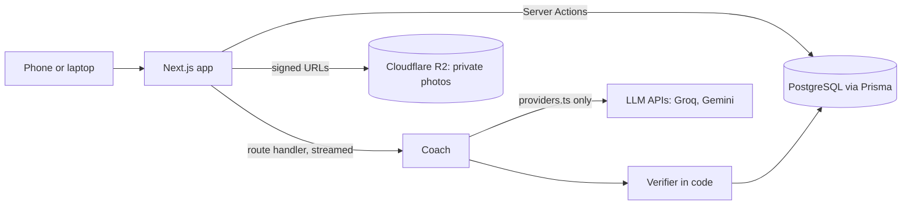

# Architecture (draft)

## How it is used

A mobile-first website, used on the phone at the gym and on a laptop at home.

| When   | What the user does                                                                                                |
| ------ | ----------------------------------------------------------------------------------------------------------------- |
| Before | Takes the quiz (goal, days a week, equipment, injuries), gets a plan built from our exercise library              |
| During | Opens today's session: logs sets with large buttons, rest timer, asks the coach ("bench is taken, what instead?") |
| After  | Sees streaks, a calendar heatmap and progress photos                                                              |

The coach is a chat panel on every page, not only the body map. Tapping a muscle on the body map opens the chat with that exercise and spot already filled in.

## The coach

**Grounded, not free-form.** Every request sends the model this user's profile, plan, last workouts, the current conversation and the matching exercise library entries. The model is stateless; the conversation lives in our database, scoped to the user, so one user's data never reaches another user's request.

**Plans are picked, not invented.** The model chooses exercises by ID from our library and fills sets, reps and rest. It cannot name an exercise we do not have.

**A verifier checks everything before it is saved or shown.** Plain TypeScript, unit-tested, no second model:

- the reply matches the JSON schema
- every exercise ID exists and fits the user's equipment and reported injuries
- sets, reps and rest are in range; no exercise twice on one day
- a swap suggestion targets the same muscle as the original

A plan that fails is regenerated once with the problems listed, then the user gets a rule-based default plan. A rate limit or outage at the provider is retried with backoff, then the request moves to the other provider (D6); only after both fail does the user see the default plan.

**The coach sees the whole library.** Every exercise the user can do (their equipment, nothing that works a reported injury) goes into the prompt by name, grouped by muscle; nothing is cut for length (D7). The model answers with names, code maps them to ids, and the verifier checks the ids.

**Safety rules are code, not prompt.** If the user reports pain (not effort), the coach stops the exercise and suggests a professional. It does not diagnose.

**Form feedback questions are bounded:** where it is felt, at which point in the rep, the weight against usual. The answers pick a fix from the exercise's library entry (cues, common mistakes), so the advice traces to text we wrote.

**AI only through `providers.ts`.** `src/lib/coach/providers.ts` is the one module that calls a model API (Groq first, Gemini as fallback, D4 and D6). No route handler, Server Action or component calls a provider directly. A new model path, such as the chat screen (#63) or the exercise chat (#70), goes through it and so gets the retries, timeouts, fallback and `coachLog` record. Coach modules pass typed data to each other, never raw model text. On `main` on 8 November, only `providers.ts` holds the provider URLs and keys. Core features (sign-in, quiz, rule-based plan, logging) work with no model key (8 November [design review](design-reviews/2026-11-08-review.md), decision 1, #76).

**No nutrition advice.** Scope is lifting, strength training and running. The coach gives no diet, calorie, supplement or meal advice; a nutrition question gets a short out-of-scope reply pointing to a registered dietitian (decision 5, #43).

**Text, not voice.** Voice adds speech-to-text, text-to-speech, microphone permissions and latency, and is not one of the course's advanced features. Streamed text replies are.

## Decisions

|     | Choice                                                                                                                                            | Why                                                                                                                                                                                                                                                                                                                                                                     | Cost                                                                                                                  |
| --- | ------------------------------------------------------------------------------------------------------------------------------------------------- | ----------------------------------------------------------------------------------------------------------------------------------------------------------------------------------------------------------------------------------------------------------------------------------------------------------------------------------------------------------------------- | --------------------------------------------------------------------------------------------------------------------- |
| D1  | Next.js App Router (option A) ([research](RESEARCH.md#2-architecture))                                                                            | Nothing outside the app calls the backend, so no public REST API is needed. Server Components load data on the server; Server Actions are typed form handlers with CSRF protection; route handlers cover the Stripe webhook and streamed coach replies                                                                                                                  | Tied to Next.js; a mobile app later needs an API                                                                      |
| D2  | PostgreSQL with Prisma                                                                                                                            | Relational data: user to plan to exercises to logged sets; typed queries and committed migrations                                                                                                                                                                                                                                                                       | Complex reports may need raw SQL                                                                                      |
| D3  | Private Cloudflare R2 bucket (S3-compatible), key in the database                                                                                 | Photos are personal; short-lived signed URLs for upload and view. R2 free tier: 10 GB-month of Standard storage, 1M Class A and 10M Class B operations a month, no egress fees ([Cloudflare R2 pricing](https://developers.cloudflare.com/r2/pricing/), checked 6 Nov 2026); DigitalOcean Spaces has no free tier. Changed 6 Nov from Spaces, as Farnaz proposed in #16 | A server round trip per photo                                                                                         |
| D4  | Groq first, Gemini as fallback ([research](RESEARCH.md#2-architecture))                                                                           | More free requests a day than Gemini, no card, and Gemini's free tier may use prompts to improve Google's products                                                                                                                                                                                                                                                      | Two providers behind one function; prompts tested on both                                                             |
| D6  | Retry, then the other provider, then the rule-based plan (30 Oct, [eval](COACH_EVAL.md))                                                          | Free tiers fail inside ten requests: Groq's 8,000 tokens a minute, Gemini's 20 requests a day on Flash; in the eval the chain served 10 of 10 plans where either provider alone did not                                                                                                                                                                                 | Two keys to manage; the fallback model (Gemini 3.5 Flash-Lite) needs a retry more often                               |
| D7  | The whole eligible exercise list in every plan prompt, as names grouped by muscle (30 Oct, [eval](COACH_EVAL.md))                                 | The team wants every exercise available to the coach; grouped names cost 4,700 tokens for the full gym against 7,900 for one line per id                                                                                                                                                                                                                                | One plan a minute per account on Groq's free tier; near-miss names need forgiving matching in code                    |
| D8  | Running weeks built by rule, capped at 10% over last week's logged distance (3 Nov, #34)                                                          | Running progressions are arithmetic; a rule is testable and needs no model call                                                                                                                                                                                                                                                                                         | Less variety than a model-written week; the coach can still explain it                                                |
| D9  | Hybrid split by goal and training mode (3 Nov)                                                                                                    | Strength or muscle goals get about 60% strength days; fat loss gets two strength days (one at two days a week) and the rest runs; a hybrid week of two or more days keeps at least one day of each kind; runners keep one strength day from three days a week and two from four, for injury prevention; at most five run days                                           | A fixed rule; chat adjustment is planned (#11), and each day passes its verifier once onboarding saves the week (#46) |
| D5  | Deploy to a hosted platform for the demo                                                                                                          | A live URL is shown in the presentation and README; it tests env vars, secrets and storage the way users meet them                                                                                                                                                                                                                                                      | Hosted database and setup time; free-tier limits. Running locally is the fallback                                     |
| D11 | Onboarding shows the rule-based plan instantly; the coach personalizes on demand (3 Nov [design review](design-reviews/2026-11-03-coach.md), #58) | No 2 to 15 second wait at sign-up and no quota spent on every new user; the model runs when the user asks, behind the same verifier                                                                                                                                                                                                                                     | The first plan is generic until the user asks the coach                                                               |
| D12 | Demo-critical coach outputs are cached and the fallback is immediate in demo mode (3 Nov design review, #59)                                      | Several people on the Groq and Gemini free tiers at once would exhaust both; a provider drop must not show a 30-second wait                                                                                                                                                                                                                                             | Cached outputs must be refreshed when the prompt changes                                                              |
| D13 | A pain question gets safe programming guidance; a pain report stops the exercise (3 Nov design review, #48)                                       | A hard stop on every mention of pain frustrates a user asking how to train safely; neither path diagnoses                                                                                                                                                                                                                                                               | One more rule to test; the line between a question and a report is decided in code                                    |
| D14 | Merge order: schema, then logic, then screens; the author merges after 72 hours without a review (3 Nov design review)                            | Ten stacked pull requests made coordination the bottleneck                                                                                                                                                                                                                                                                                                              | Some code merges having been read only by its author                                                                  |
| D15 | Vercel Hobby for the app, Neon Free for PostgreSQL (5 Nov, #57; sources below)                                                                    | Both free; Vercel builds Next.js with no server to run and gives every pull request a preview URL; functions run up to 300 s, enough for a streamed coach reply; Neon keeps the database with no expiry. Beat Render and Railway (details below)                                                                                                                        | Hobby is non-commercial; Neon sleeps after 5 idle minutes; previews share one Neon branch (below)                     |

D15 details. Why: Both free (Neon states no card; Vercel's pricing page does not say); Vercel builds Next.js with no server to run and gives every pull request a preview URL; functions run up to 300 s, enough for a streamed coach reply; Neon keeps the database with no expiry. Beat Render (free PostgreSQL deleted 30 days after creation, web service sleeps after 15 minutes and takes about a minute to wake) and Railway ($5 trial for 30 days, then $1 a month of credit for all usage). Cost: Hobby is non-commercial and capped with no paid overage, and only the repository owner (Mohammad) can import the repository into Vercel; Neon suspends after 5 idle minutes, so the first query after a pause is slower, and Free allows 100 CU-hours a month per project; previews use a separate Neon `preview` branch with Preview-scoped variables (Prisma's Vercel guide), shared by all open pull requests and created from a `seed` branch that holds only the seed data, so Reset from parent never copies real users from `main`; migrations run before each build goes live, so they stay additive. A hosted build stops before any step when `DATABASE_URL` or `DATABASE_URL_UNPOOLED` is missing or the two point at different databases, and the direct URL is read only on Vercel, so a local test migration always reaches the test database (10 Nov review).

D15 sources, checked 5 Nov 2026: [Vercel pricing](https://vercel.com/pricing), [Vercel function limits](https://vercel.com/docs/functions/limitations), [Vercel build configuration](https://vercel.com/docs/builds/configure-a-build), [Vercel system environment variables](https://vercel.com/docs/environment-variables/system-environment-variables), [Neon pricing](https://neon.com/pricing), [Neon with Prisma](https://neon.com/docs/guides/prisma), [Neon regions](https://neon.com/docs/introduction/regions), [Prisma on Vercel](https://www.prisma.io/docs/orm/prisma-client/deployment/serverless/deploy-to-vercel), [Vercel for GitHub](https://vercel.com/docs/git/vercel-for-github), [Vercel Git deployments](https://vercel.com/docs/git), [Vercel Node.js versions](https://vercel.com/docs/functions/runtimes/node-js/node-js-versions), [Render free tier](https://render.com/docs/free), [Railway pricing](https://railway.com/pricing).

## Testing

Three layers, each owner testing their own slice (8 November design review, decision 4):

1. **Unit:** pure logic (the coach, progression, schemas) with model calls replaced by saved replies; runs offline in CI.
2. **API mocking at the provider boundary:** `providers.ts` faked so timeouts, invalid JSON and rate limits are tested on purpose.
3. **Integration:** Server Actions run against a real PostgreSQL in CI, covering tier checks, saving a week and logging a set (#79; not in CI yet).

The CI pipeline is itself tested: a deliberately failing check must fail the run.

Evidence for the design choices: one note per paper in [docs/papers](papers/README.md).

## Advanced features

Promised: authentication with four access tiers checked on the server; external APIs (the coach).
Planned ([shortcuts](RESEARCH.md#3-plan-shortcuts-for-the-advanced-features)): real-time (streamed replies, notifications), photo processing (resize, strip location, then-vs-now image), Redux Toolkit for the quiz, body map and workout session, Stripe test mode.

## Open

Listed in [RESEARCH.md](RESEARCH.md#for-the-next-meeting) for the next meeting.
