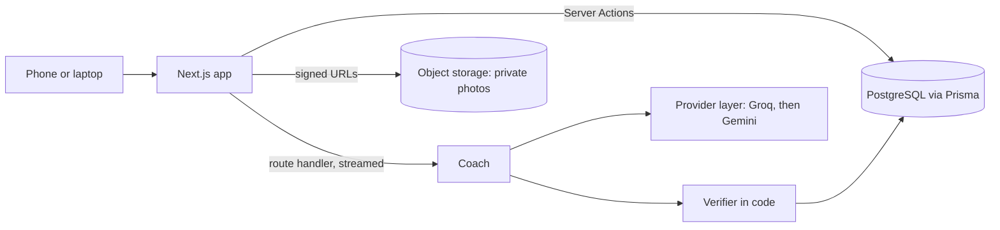

## 2. Objectives, Architecture, and Key Features

### 2.1 Objectives

FitnessCoach gives a person a weekly training plan that fits their equipment, injuries and available days, lets them log the session on their phone at the gym, and answers questions about a movement in context. The design is organised around trust: every plan is checked in code against the user's own profile before anyone sees it, and the app keeps working when the model provider does not. Core functionality: a quiz (goal, days a week, equipment, injuries, occupation and lifestyle), plan generation from an 876-exercise library, a session screen with set logging and a rest timer, a chat coach that knows the user's plan and history, a body map that opens the chat with the exercise and the spot filled in, and progress tracking (history, streaks, photos). Lifting and running are planned together: strength days come from the model, running days (distance, pace, session type) from rules, and both pass the same verifier.

### 2.2 Architecture

Option A, Next.js full-stack with the App Router. Nothing outside the app calls the backend, so Server Components read data on the server, Server Actions handle every form, and two route handlers cover what Server Actions cannot: the streamed coach reply and the Stripe webhook. TypeScript throughout, Tailwind CSS with shadcn/ui, PostgreSQL through Prisma with committed migrations and a seed, and an S3-compatible bucket for photos. Prettier, ESLint, Vitest and GitHub Actions run on every pull request.

**Components and data flow.** The quiz writes a `Profile` through a Server Action validated by a Zod schema. The coach builds a prompt from the profile and the exercises the user can do, calls the provider layer, maps the reply back to library ids and runs the verifier; a plan that passes is saved as `Plan`, `PlanDay` and `PlanExercise` rows and shown. The session screen reads today's `PlanDay` and writes a `SetLog` per tap, returning the updated day without a refresh. Chat is a route handler that streams the reply token by token into `Message` rows under a `Conversation` scoped to the user; the model is stateless, so one user's data never reaches another's request. The body map opens the chat with the exercise id and spot prefilled, so the answer is grounded in a library entry.

**Database.** Eleven Prisma models. `User` carries a `tier` enum (free, trial, pro, admin) and is one to one with `Profile`. `Exercise` is the library, seeded from free-exercise-db (public domain) with our own form cues. `Plan` has many `PlanDay`, each with `PlanExercise` slots that reference an `Exercise` by id, so a plan can only contain exercises we hold. `Workout` and `SetLog` record what was done; `ProgressPhoto` holds a bucket key and a date. Running adds a plan type and distance, pace and session type on the slot in one migration. Reads go through Prisma's typed client; writes go through Server Actions whose Zod schemas also type the forms.

**Cloud storage.** Photos are personal, so the bucket is private and nothing is served by public URL. Upload and view use signed URLs the server issues for a few minutes; `sharp` resizes and strips metadata (including GPS) before storage; the database keeps only the key, tied to the user.

**UI and UX.** The app is used on the gym floor, so it is mobile-first: large touch targets for logging, a rest timer visible without scrolling, fast loads on a phone connection; `loading.tsx` and `error.tsx` per route give every screen a loading and error state.

### 2.3 Advanced features

**Integration with an external AI API (the coach).** One model call behind code: the prompt offers every exercise the user can do, grouped by muscle; the reply is parsed against a Zod schema and checked by a TypeScript verifier (ids exist, equipment owned, injuries avoided, ranges, no duplicates, right number of days); a failing plan is regenerated once with the problems listed, then a rule-based plan is used. Safety rules (stop on pain, suggest a professional) live in code, not the prompt. Two providers sit behind one function: Groq's `gpt-oss-120b` leads, Gemini 3.5 Flash-Lite is the fallback, and a rate limit or outage is retried with the provider's own wait before switching. Measured on ten fixed profiles: each provider alone failed inside ten requests on its free tier; the chain served ten of ten verified plans.

**Authentication and authorization.** Better Auth with the Prisma adapter, so users and sessions live in our PostgreSQL beside the tier Stripe sets, and sessions can be ended on the server. Four tiers are checked on the server in every Server Action and route handler: free (plans and tracking), trial, pro (chat coach, unlimited plans), admin (library content). Stripe test mode moves a user between tiers through the webhook.

Planned beyond the two: streamed coach replies (real-time), photo processing with `sharp`, and Redux Toolkit for the quiz, body map and session state shared across components.

### 2.4 Trade-offs, risks and scope

| Decision                                       | Why                                                                    | Cost                                                                               |
| ---------------------------------------------- | ---------------------------------------------------------------------- | ---------------------------------------------------------------------------------- |
| Next.js full-stack over a separate Express API | No outside caller; Server Actions give typed, CSRF-protected mutations | A later mobile app would need an API                                               |
| Better Auth over Auth0                         | User store stays ours beside the Stripe tier; no per-user billing      | We run auth ourselves                                                              |
| Groq first, Gemini fallback, retry in code     | Free tiers fail inside ten requests; measured                          | Two keys; the fallback model needs a retry more often                              |
| Whole exercise library in the prompt           | The coach sees every exercise the user can do                          | One plan a minute per account on Groq's free tier; near-miss names matched in code |
| Rule-based plan as last resort                 | The demo never shows an empty screen                                   | A plain plan when both providers are down                                          |

Failure handling: a provider limit or outage is retried, switched, then replaced by the rule-based plan or a cached coach reply; two regenerations of one plan are serialised with an `updatedAt` check; every model call has a 30-second timeout; a malformed reply never reaches the database because the schema and verifier run first.

The scope is feasible for four people by 6 December: the foundation is on `main` (schema, seed, CI, coach logic with 32 tests) and the areas are independent (accounts; quiz and session; progress and photos; coach). Features and new code stop on 23 November; the last two weeks are testing, the report and the video. The demo path is sign-in, quiz, plan, logged workout and one coach exchange; photos, streaks and Stripe sit off that path and can slip without breaking it.
