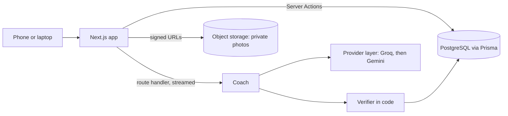

## 2. Objectives, Architecture, and Key Features

### 2.1 Objectives

FitnessCoach gives a person a weekly training plan that fits their equipment, their injuries and the days they have, lets them log the session on their phone at the gym, and answers questions about a movement in context. The objective that organises the design is trust: every plan the coach produces is checked in code against the user's own profile before anyone sees it, and the app keeps working when the model provider does not. Core functionality: a quiz (goal, days a week, equipment, injuries, occupation and lifestyle), plan generation from an 876-exercise library, a session screen that logs sets with a rest timer, a chat coach that knows the user's plan and history, a body map that opens the chat with the exercise and the spot filled in, and progress tracking (history, streaks, photos). Lifting and running are planned together: strength days come from the model, running days (distance, pace, session type) from rules, and both pass the same verifier.

### 2.2 Architecture

We use Option A, Next.js full-stack with the App Router. Nothing outside the app calls the backend, so Server Components read data on the server, Server Actions handle every form (quiz, set log, photo metadata), and two route handlers cover what Server Actions cannot: the streamed coach reply and the Stripe webhook.

**Components and how they interact.** The quiz writes a `Profile`. The coach builds a prompt from the profile and the exercises the user can do, calls the provider layer, maps the reply back to library ids, and runs the verifier; a plan that passes is saved as `Plan`, `PlanDay` and `PlanExercise` rows and shown. The session screen reads today's `PlanDay` and writes `Workout` and `SetLog` rows as the user taps. Chat stores `Message` rows under a `Conversation` scoped to the user; the model itself is stateless, so one user's data never reaches another user's request. Photos go straight from the browser to a private bucket through a short-lived signed URL; the database stores only the object key.

**Database design.** Eleven Prisma models in PostgreSQL. `User` (with a `tier` enum: free, trial, pro, admin) and `Profile` are one to one. `Exercise` is the library, seeded from free-exercise-db (public domain) with our own form cues added. `Plan` has many `PlanDay`, each with many `PlanExercise` slots that reference an `Exercise` by id, so a plan can only contain exercises we hold. `Workout` and `SetLog` record what was actually done against the plan. `Conversation` and `Message` hold the chat. `ProgressPhoto` holds the bucket key and date. Running adds a plan type on `Plan` and distance, pace and session type on the slot, one migration. Data is read through Prisma's typed client in Server Components; writes go through Server Actions whose inputs are validated by Zod schemas, the same schemas that type the forms.

**Cloud storage.** Progress photos are personal, so the bucket is private and nothing is served by public URL. Upload and view both use signed URLs the server issues for a few minutes; `sharp` resizes the image and strips metadata (including GPS) before it is stored. The `ProgressPhoto` row ties the key to the user and the date, so the history view can list a user's photos without ever exposing another user's.

**Key data flows.** Quiz to plan: Server Action validates with Zod, writes the profile, calls the coach, saves the verified plan, redirects to it. Session: each set is one Server Action that writes a `SetLog` and returns the updated day, so the page stays current without a refresh. Chat: a route handler streams the reply token by token; the client renders as it arrives. Body map: tapping a muscle opens the chat with the exercise id and spot prefilled, so the coach's answer is grounded in a library entry.

**UI and UX.** The app is used on the gym floor, so it is mobile-first: large touch targets for logging a set, a rest timer that is visible without scrolling, pages that load fast on a phone connection. Tailwind CSS and shadcn/ui components keep the screens consistent; `loading.tsx` and `error.tsx` per route give every screen a loading and error state without hand-written spinners.

### 2.3 Required technologies

TypeScript throughout, frontend and server. Next.js App Router with React Server Components, Server Actions and route handlers. Tailwind CSS with shadcn/ui. PostgreSQL through Prisma, with committed migrations and a seed script. An S3-compatible object store for photos. Responsive layout tested on phone and laptop widths. Prettier, ESLint, Vitest and GitHub Actions run on every pull request, so a change that breaks formatting, types, tests or the build cannot merge.

### 2.4 Advanced features

**Integration with an external AI API (the coach).** The coach is one model call behind code: the plan prompt offers every exercise the user can do, grouped by muscle; the reply is parsed against a Zod schema and checked by a TypeScript verifier (ids exist, equipment owned, injuries avoided, ranges, no duplicates, right number of days); a failing plan is regenerated once with the problems listed, then a rule-based plan is used. Safety rules (stop on pain, suggest a professional) live in code, not in the prompt. Two providers sit behind one function: Groq's `gpt-oss-120b` leads, Gemini 3.5 Flash-Lite is the fallback, and a rate limit or outage is retried with the provider's own wait before switching. We measured this on ten fixed profiles: each provider alone failed inside ten requests on its free tier, and the chain served ten of ten verified plans.

**Authentication and authorization.** Better Auth with the Prisma adapter, so users and sessions live in our PostgreSQL next to the tier Stripe sets; sessions are database-backed and can be ended on the server. Four tiers are checked on the server in every Server Action and route handler: free (plans and tracking), trial, pro (chat coach, unlimited plans) and admin (library content). Stripe test mode moves a user between tiers through the webhook.

Planned beyond the two: real-time streamed coach replies, photo processing with `sharp`, and Redux Toolkit for the quiz, body map and session state that several components share.

### 2.5 Trade-offs, risks and scope

| Decision                                       | Why                                                                    | Cost                                                                               |
| ---------------------------------------------- | ---------------------------------------------------------------------- | ---------------------------------------------------------------------------------- |
| Next.js full-stack over a separate Express API | No outside caller; Server Actions give typed, CSRF-protected mutations | A later mobile app would need an API                                               |
| Better Auth over Auth0                         | User store stays ours beside the Stripe tier; no per-user billing      | We run auth ourselves                                                              |
| Groq first, Gemini fallback, retry in code     | Free tiers fail inside ten requests; measured on test profiles         | Two keys; the fallback model needs a retry more often                              |
| Whole exercise library in the prompt           | The coach should see every exercise the user can do                    | One plan a minute per account on Groq's free tier; near-miss names matched in code |
| Rule-based plan as last resort                 | The demo never shows an empty screen                                   | A plain plan when both providers are down                                          |

Failure handling: a provider rate limit or outage is retried, then switched, then replaced by the rule-based plan or a cached coach reply; two regenerations of the same plan are serialised with an `updatedAt` check; every model call has a 30-second timeout; a malformed reply never reaches the database because the schema and verifier run first.

Scope is feasible for four people by 6 December because the foundation is already on `main` (schema, seed, CI, coach logic with 32 tests) and the areas are independent: accounts, quiz and session, progress and photos, coach. Features and new code stop on 23 November; the last two weeks are testing, the report and the video. The demo path is sign-in, quiz, plan, logged workout and one coach exchange; photos, streaks and Stripe sit off that path and can slip without breaking it.
