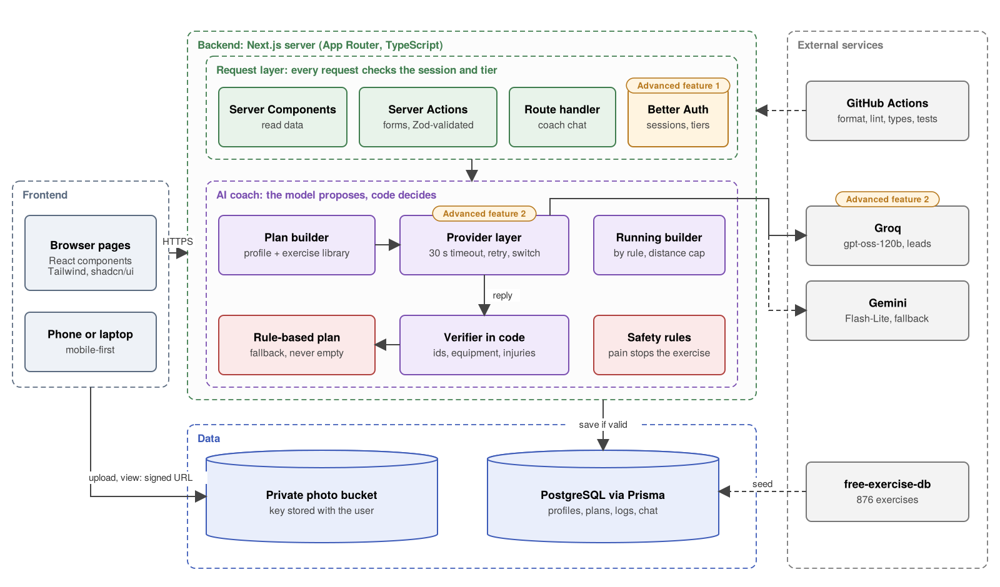

## 2. Objectives, Architecture, and Key Features

### 2.1 Objectives

FitnessCoach is a personalized fitness coach. A short quiz produces a weekly plan for the gym, running or both that fits the user's goal, equipment, schedule, injuries and daily life; the user logs each session on their phone, and plan and progress update as they train. A coach chat answers questions in the context of the user's own plan.

The technical objective is a coach people can trust: every plan is checked in code before it is saved, and the app handles dropped connections, bad input and model outages without losing data or showing an empty screen.

### 2.2 Architecture and data flow

*Figure 1. Solid lines carry requests and data; dashed lines are the fallback provider, seeding and CI.*

We use Option A, Next.js full-stack with the App Router, because no outside client calls our backend. The frontend is React components styled with Tailwind CSS and shadcn/ui. It talks to the backend in three ways: Server Components load data on the server before the page renders; Server Actions, typed functions validated by Zod, handle every form and save; and one route handler serves coach chat. Every request checks the Better Auth session and the user's tier on the server.

The AI coach is a backend module where the model proposes and code decides: the plan builder sends the profile and every exercise the user can do, the provider layer makes the call, and only a plan that passes the verifier is saved.

**UI and UX.** Mobile-first for use mid-workout: large touch targets for logging sets, a rest timer visible without scrolling, and a loading and error state on every route.

### 2.3 Database and cloud storage

Each Prisma entity serves a feature:

| Entity | Relationships | Feature it serves |
| --- | --- | --- |
| `User`, `Profile` | one to one; goal, mode, days, equipment, injuries, occupation, activity level | Sign-in, tiers, the quiz |
| `Exercise` | referenced by plan slots and set logs | The 876-exercise library, with our form cues |
| `Plan`, `PlanDay` | user has many plans; plan has many days (strength, run or rest) | The weekly plan |
| `PlanExercise`, `PlanRun` | strength slots reference an `Exercise` id; a run day has type, distance, pace | Plans contain only exercises we hold |
| `Workout`, `SetLog`, `RunLog` | user has many workouts; each has set logs or a run log | Session logging, history, streaks |
| `Conversation`, `Message` | user has many; body-map messages keep exercise and region | Coach chat that remembers feedback |
| `ProgressPhoto` | user has many photos; stores a key, not the file | Progress photos |

Reads go through Prisma's typed client from Server Components; writes go through Server Actions, and every query is filtered by the signed-in user's id. Photos meet the cloud storage requirement: the bucket is private, the server issues upload and view URLs that expire after a few minutes, and `ProgressPhoto` keeps only the key.

### 2.4 Key design decisions

| Decision | Why it fits FitnessCoach | Trade-off |
| --- | --- | --- |
| The model picks exercise ids from our library | It cannot invent an exercise or prescribe one the user cannot do | The library fills the prompt: one plan a minute per account on Groq's free tier |
| Running by rule; strength by the model | Running progressions are arithmetic; strength choices benefit from the model | Less variety in running plans |
| Better Auth, not Auth0 | Users and sessions stay in our PostgreSQL beside the tier | We run authentication ourselves |
| Groq first, Gemini as fallback | In our test each free tier failed within ten requests; the chain served ten verified plans of ten | Two keys to manage |

### 2.5 Failure handling, error states and testing

A failure degrades one capability, never the whole app: without a model provider, users still get a rule-based plan and can log workouts.

| Failure | How the app responds |
| --- | --- |
| Dropped connection while logging | The entry stays on screen, marked unsaved, with a retry; a client id under a unique key means a retry never logs twice |
| Dropped connection during chat | The reply is saved on the server as it completes; reopening the chat loads it from the conversation |
| Bad input | Zod on the form and again in the Server Action; field errors in plain words, never a stack trace |
| Model slow, rate-limited or down | 30-second timeout, a retry after the provider's stated wait, then the other provider, then the rule-based plan; chat shows a cached reply |
| Malformed or unsafe plan | Schema check, then the verifier (ids exist, equipment owned, injuries avoided, ranges, no duplicates, day count); one regeneration with the problems listed |
| Out-of-scope or unsafe chat | Rules in code, not the prompt: reported pain stops the exercise and suggests a professional; the coach does not diagnose |

Every model call is logged with provider, prompt version, latency and outcome. Testing runs from the first commit: Vitest unit tests with the network mocked, CI (format, lint, types, tests, build) on every pull request, and ten fixed coach profiles replayed in CI. From mid-November we use the app at the gym and log what breaks.

### 2.6 How the required technologies are used

| Requirement | Our use |
| --- | --- |
| TypeScript, Next.js | App Router: Server Components, Server Actions, one route handler |
| Tailwind CSS, shadcn/ui | Mobile-first, responsive screens |
| PostgreSQL | Prisma schema, migrations, seeded library |
| Cloud storage | Private bucket for progress photos |

### 2.7 Advanced features

We commit to two:

1. **Authentication and authorization.** Better Auth sign-in, with four tiers checked on the server in every Server Action and route handler: free (plans and logging), trial, pro (adds the coach chat), admin (edits the exercise library).
2. **Integration with an external AI API.** The coach writes strength plans and answers chat through Groq with Gemini as fallback, behind the verifier; its plans land in the tables the session screen reads.

One planned extension, reported as finished only if it is: **real-time** coach replies streamed token by token.

### 2.8 Scope and feasibility

We have started: the Next.js skeleton, the Prisma schema and first migration, the seeded library, CI, and plan generation with the verifier are on `main`, and the provider layer is in review with 32 tests. Each area (accounts; quiz and session; progress and photos; coach) builds against the shared schema and merges weekly. Voice, camera form checks and payments are out of scope. Demo features freeze on 23 November; the demo path is sign-in, quiz, plan, a logged workout and one coach exchange.
