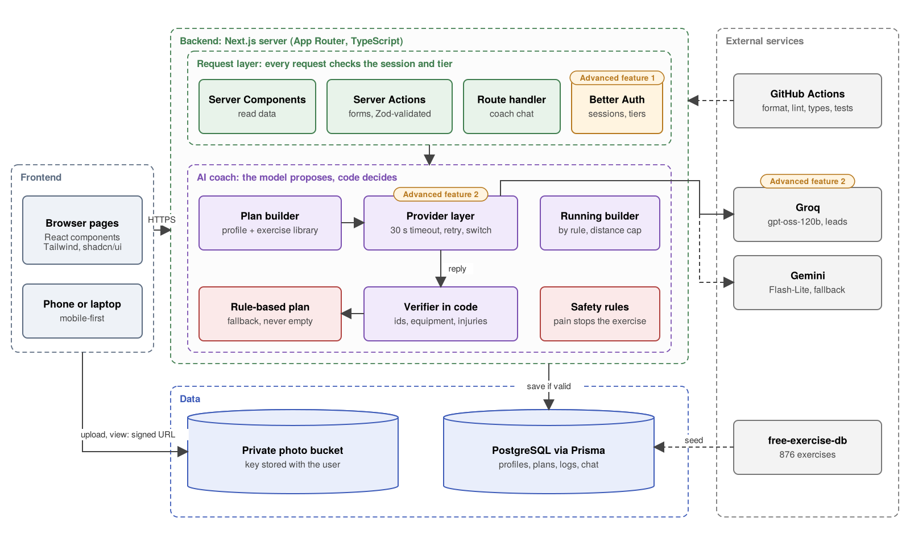

## 1\. Motivation

Many people struggle to maintain consistent exercise routines, even after beginning a fitness program. Research involving 5,240 fitness-centre members found that 63% of new members discontinued their memberships before the third month, highlighting the challenge of sustaining physical activity (Sperandei et al., 2016). A review also identified professional support, habit formation, and personal characteristics as important influences on exercise adherence (Gabay & Oravițan, 2022). These findings motivate the need for fitness guidance that can adapt to users rather than relying solely on predefined routines.

Our primary users are individuals seeking accessible, personalized fitness coaching without the expense of a dedicated human personal trainer. This includes beginners who need guidance when learning exercises and experienced individuals who want recommendations that account for their feedback. These users need more than workout plans; they need an interactive system that can respond to their experiences and help them make informed training decisions. The app is intended to provide this support between sessions, grounding exercise guidance in its library rather than requiring users to wait for their next appointment.

Several existing applications address aspects of this problem. SensAI offers an AI-powered conversational coach, Google Health Coach builds Gemini-based weekly plans but requires a Fitbit or Pixel Watch (Google, 2026), Fitbod generates strength-training sessions, and JuggernautAI adjusts powerlifting programs based on training feedback. Future provides access to human coaches through messaging. Our competitor review did not identify an application that combines strength training and running within a single personalized plan while also allowing users to indicate where they feel a movement through an interactive body map. Competitor pricing also varies considerably, from $6.99 per month for SensAI to $199 per month for Future. FitnessCoach is intended to use a free trial followed by a low-cost subscription (Stripe test mode in this build), placing it within the range of AI coaching apps and well below the cost of a human coach.

FitnessCoach will combine personalized strength and running programs with an interactive body map for reporting where a movement is felt. This feedback tailors later coaching to each user's goals, preferences and experience.

## 2. Objectives, Architecture, and Key Features

### 2.1 Objectives

A short quiz produces a weekly gym, running or hybrid plan that fits the user's goal, equipment, schedule, injuries and daily life; the user logs sessions on their phone, and plan and progress update as they train. A coach chat answers questions about the user's own plan.

The technical objective is a trustworthy coach: code checks every plan before it is saved, and failures never lose data or leave an empty screen.

### 2.2 Architecture and data flow

_Figure 1. Dashed lines: fallback provider, seeding and CI._

We use Option A, Next.js full-stack with the App Router: no outside client calls our backend. The React frontend (Tailwind CSS, shadcn/ui) reaches the backend three ways: Server Components load data before the page renders, Server Actions validated by Zod handle every form, and one route handler serves coach chat.

In the AI coach the model proposes and code decides: only a plan that passes the verifier is saved.

**UI and UX.** Mobile-first for mid-workout use: large touch targets, a visible rest timer, and loading and error states on every route.

### 2.3 Database and cloud storage

| Entity                        | Relationships                                                                 | Feature                                                            |
| ----------------------------- | ----------------------------------------------------------------------------- | ------------------------------------------------------------------ |
| `User`, `Profile`             | one to one; goal, mode, days, equipment, injuries, occupation, activity       | Sign-in, tiers, quiz                                               |
| `Exercise`                    | used by plan slots and set logs                                               | 876 exercises from free-exercise-db (Yuhonas, n.d.), with our cues |
| `Plan`, `PlanDay`             | user has many plans; plan has many days (strength, run or rest)               | The weekly plan                                                    |
| `PlanExercise`, `PlanRun`     | slots reference an `Exercise`; runs have type, distance, pace                 | Only exercises we hold                                             |
| `Workout`, `SetLog`, `RunLog` | user has many workouts; each has set logs or a run log                        | Logging, history, streaks                                          |
| `Conversation`, `Message`     | user has many, each with messages; body-map messages keep exercise and region | Chat that remembers feedback                                       |
| `ProgressPhoto`               | user has many; stores a key, not the file                                     | Progress photos                                                    |

Server Components read through Prisma, Server Actions write, and every query is filtered by the signed-in user's id. Photos meet the cloud storage requirement: a private bucket, upload and view URLs from the server that expire within minutes, and only the key in `ProgressPhoto`.

### 2.4 Key design decisions

| Decision                               | Why it fits FitnessCoach                                                                                                                                   | Trade-off                                                               |
| -------------------------------------- | ---------------------------------------------------------------------------------------------------------------------------------------------------------- | ----------------------------------------------------------------------- |
| The model picks only from our library  | No invented exercises, none the user cannot do                                                                                                             | A long prompt: about one plan a minute on Groq's free tier (Groq, 2026) |
| Running by rule, strength by the model | Running progression is arithmetic; strength choice benefits from a model                                                                                   | Less varied running plans                                               |
| Better Auth, not Auth0                 | Users and sessions stay in our database beside the tier (Better Auth, 2026)                                                                                | We run authentication ourselves                                         |
| Groq first, Gemini as fallback         | In our [test](https://github.com/harunm1/FitnessCoach/blob/main/docs/COACH_EVAL.md) each free tier failed within ten requests; the chain served ten of ten | Two keys to manage                                                      |

### 2.5 Failure handling, error states and testing

A failure degrades one capability, never the whole app: without a model, users still get a rule-based plan.

| Failure                          | How the app responds                                                                                                         |
| -------------------------------- | ---------------------------------------------------------------------------------------------------------------------------- |
| Dropped connection while logging | The entry stays on screen, marked unsaved, with a retry; a retry never stores a set or run twice                             |
| Dropped connection during chat   | The server saves the finished reply; reopening the chat loads it                                                             |
| Bad input                        | Zod on the form and in the Server Action; plain errors, no stack trace                                                       |
| Model slow, rate-limited or down | 30-second timeout, a short retry, the other provider, then the rule-based plan; chat shows a cached reply                    |
| Malformed or unsafe plan         | Schema check, then the verifier (ids, equipment, injuries, ranges, duplicates, day count); one regeneration listing problems |
| Out-of-scope or unsafe chat      | Rules in code: reported pain stops the exercise and suggests a professional; no diagnosis                                    |

Every model call will be logged with provider, prompt version, latency and outcome. Vitest unit tests mock the network; CI runs format, lint, types, tests and build on every pull request, and will replay ten fixed coach profiles. From mid-November we pilot the demo path on a deployed preview and log what breaks as issues labelled `pilot`.

### 2.6 How the required technologies are used

TypeScript throughout; Next.js, Tailwind CSS and shadcn/ui as in 2.2; PostgreSQL through Prisma migrations and the seeded library; cloud storage as the private photo bucket in 2.3.

### 2.7 Advanced features

We commit to two:

1. **Authentication and authorization.** Better Auth sign-in; four tiers checked on the server in every Server Action and route handler: free (quiz, rule-based plan, logging), trial (coach chat until it ends), pro (coach chat while verified paid access lasts), admin (edits the library).
2. **Integration with an external AI API.** Groq, with Gemini as fallback, writes strength plans and answers chat behind the verifier; plans land in the session screen's tables.

One planned extension, reported only if finished: **real-time** coach replies streamed a sentence at a time, each checked before it is shown.

### 2.8 Scope and feasibility

On `main`: the Next.js skeleton, strength schema and first migration, seeded library, CI, plan generation with the verifier, and provider fallback. Each owner's area builds against the shared schema and merges weekly. Voice and camera form checks are out of scope; Stripe test-mode upgrades to pro are a stretch off the demo path.

## 3. Plan and Responsibilities

During team formation, we shared backgrounds and preferences and divided work around our strengths.

### 3.1 Stages

The course health check on 18 November and final report on 6 December anchor our schedule. We build in four stages: foundation (schema, authentication, CI), the core path, integration and demo features, then testing and the report. Our core path—sign-in, quiz, plan, logged workout and one coach exchange—is due 15 November. Demo features freeze on 23 November; 24–26 November goes to slides, rehearsals and live-demo testing. Development and polishing continue until the report.

### 3.2 Responsibilities

Nabeegh owns foundation (schema, seed, CI) and the AI coach, including running plans. Shubham owns accounts, access tiers, backend integration and optional Stripe billing. Mohammad owns quiz, body map and session screens. Farnaz owns workout history, progress photos and cloud storage. Running is built alongside lifting.

### 3.3 Integration and Dependencies

Every Tuesday at 7 p.m., each member reports what they built, blockers and next steps. Questions, decisions and blockers stay on related GitHub issues; Discord handles scheduling. Team brainstorming, informed by our [research](https://github.com/harunm1/FitnessCoach/blob/main/docs/RESEARCH.md) and [coach evaluations](https://github.com/harunm1/FitnessCoach/blob/main/docs/COACH_EVAL.md), settles design.

The shared Prisma schema, workout-plan JSON and authentication are the critical path: signed-in quiz, session and progress integration depends on them. Each task has an issue, branch and PR with `Closes #n`, covering one feature or fix for review in one sitting. Code and proposal PRs need one teammate approval; proposal/documentation PRs request all teammates. No teammate receives more than three small, separate PRs daily. Branches merge weekly so the app runs together. Meeting/admin notes may go directly to unprotected `main`. CI runs formatting, lint, TypeScript checks, tests and build.

### 3.4 Risks and Scope

We use the app ourselves as each piece lands. LLM failures trigger Groq retries, then Gemini; if both fail, a rule-based plan and cached coach reply keep the demo live. A recording is the last resort. We discuss schema changes and retain a stable demo if integration or feature work slips.

## 4. Initial Team Reasoning and AI-Assisted Exploration

### 4.1 Initial Team Reasoning

Initially, we defined the problem simply. A user takes a quiz about their goals and where they train, receives a workout plan, and an AI coach explains each exercise and keeps them on track. Two early ideas shaped the design. First, users would describe how a movement feels in chat with the coach, so we would not need a camera or video processing. Second, the coach would use a free LLM API, with Gemini as our first choice and Groq as a backup. We left three questions open: which provider to rely on, whether to support running as well as gym workouts, and which extras, such as progress photos and Stripe payments, to include.

### 4.2 Exploration and Evaluation

Our research on free-tier limits pointed to Groq, and the team tested both providers to confirm it. We wrote down how we would judge the results, then asked Groq and Gemini to create plans for the same ten user profiles. In the first round, both produced plans that passed our verifier. The real difference was reliability: on its own, each provider failed some requests because of free-tier limits or server errors.

AI helped us build this test, and we checked its answers. It assumed Groq reports how long to wait in a standard `Retry-After` header, but Groq's actual responses use a different header, so our retry logic reads that one. AI also suggested sending only six exercises per muscle group to fit Groq's token limit. We tried it and rejected it, because the coach should see every exercise the user can do; grouping names by muscle made them all fit.

### 4.3 How the Design Changed

Instead of choosing one provider, we now chain them as described in Section 2, and in our test the chain produced ten verified plans out of ten. Running is included from the start, progress photos meet the cloud storage requirement, and Stripe test mode became a stretch.

<!-- One reference list for all four proposal sections, APA style, alphabetical. -->

## References

Better Auth. (2026). _Prisma_ [Documentation]. https://www.better-auth.com/docs/adapters/prisma

Gabay, M., & Oravițan, M. (2022). The factors affecting adherence to physical activity in fitness facility settings: A narrative review. _Timișoara Physical Education and Rehabilitation Journal, 15_(29), 46–61. https://doi.org/10.2478/tperj-2022-0013

Google. (2026). _What is new with the redesigned Google Health app_ [Documentation]. Google Health Help Center. https://support.google.com/googlehealth/answer/17068213

Groq. (2026). _Rate limits_ [Documentation]. GroqCloud. https://console.groq.com/docs/rate-limits

Sperandei, S., Vieira, M. C., & Reis, A. C. (2016). Adherence to physical activity in an unsupervised setting: Explanatory variables for high attrition rates among fitness center members. _Journal of Science and Medicine in Sport, 19_(11), 916–920. https://doi.org/10.1016/j.jsams.2015.12.522

Yuhonas. (n.d.). _free-exercise-db_ [Data set]. GitHub. https://github.com/yuhonas/free-exercise-db
